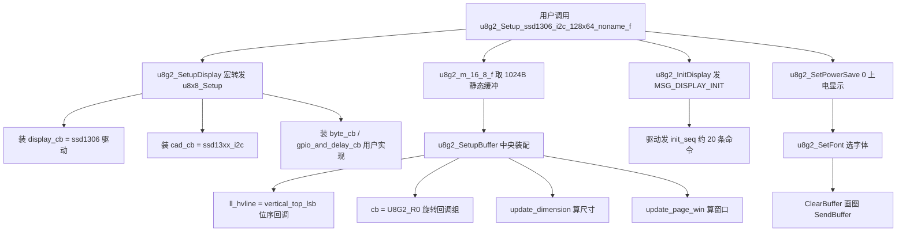

# u8g2 源码详解 00：总览与架构

> 涉及文件：
> - `csrc/u8g2.h`（核心结构体 u8g2_t / u8g2_cb_t 与全部 API 契约）
> - `csrc/u8x8.h`（通信层结构体 u8x8_t / u8x8_display_info_t / 消息号定义）
> - `csrc/u8g2_setup.c`（中央装配 u8g2_SetupBuffer + 旋转回调组）
> - `csrc/u8g2_d_setup.c`（1104 个屏幕装配函数，生成代码）
> - `csrc/u8g2_d_memory.c`（225 个缓冲分配函数，生成代码）
> - `csrc/u8x8_8x8.c`、`csrc/u8x8_cad.c`、`csrc/u8x8_byte.c`（u8x8 通信栈）

---

## 1. u8g2 是什么：一句话与三个数字

u8g2 是单片机**单色屏**图形库：无第三方依赖的纯 C，一条绘制管线支持 200+ 种控制器
（SSD1306、SH1106、ST7565、ST7920、SSD1606 电子纸、MAX7219 点阵……）。

三个值得记住的量化锚点（128x64 屏、AVR 基准）：

| 指标 | 数值 | 出处 |
|---|---|---|
| 全缓冲 RAM | 16 tile 宽 × 8 行 × 8 字节 = **1024 B** | `u8g2_d_memory.c` 的 `u8g2_m_16_8_f` |
| 单页缓冲 RAM | 16 × 8 × 1 = **128 B**（页模式） | `u8g2_m_16_8_1` |
| 上下文 u8g2_t | 约 **100~200 B**（随 16BIT/CLIP/PROGMEM 配置浮动） | `csrc/u8g2.h` 的 `struct u8g2_struct` |

对照 u8g2.h 头部自带的 AVR 体积表（`csrc/u8g2.h` L45~L52 附近）：关闭字体旋转 +
关闭相交检查后，text 示例可压到 6880 B flash——**所有重型特性都是可裁剪的编译开关**。

## 2. 双层架构：u8g2（图形层）骑在 u8x8（通信层）上

README.md 把两者的分工写得很直白：

| 维度 | u8g2（本笔记主角） | u8x8 |
|---|---|---|
| 抽象 | **位图图形库**：任意字体、任意图元 | **字符设备**：只认 8x8 点阵字模 |
| 缓冲 | RAM 帧缓冲（全缓冲或页模式） | **无缓冲**，直接写控制器 |
| 字体 | 约 400 个（可含 unicode BMP） | 只有 8x8 点阵字模 |
| 上下文 | `u8g2_t`（内嵌 `u8x8_t` 作为第一成员） | `u8x8_t` |
| 典型代价 | 1 KB RAM（128x64 全缓冲） | 0 RAM（无缓冲） |

"内嵌"是理解源码的第一个钥匙。`csrc/u8g2.h` 的 `struct u8g2_struct` 第一个成员是
`u8x8_t u8x8;`，于是有了零开销的降级宏：

```c
// csrc/u8g2.h —— u8g2_t 首成员是 u8x8_t，指针可直接强转
#define u8g2_GetU8x8(u8g2) ((u8x8_t *)(u8g2))
```

u8g2 的所有通信 API（`u8g2_InitDisplay`、`u8g2_SetPowerSave`、`u8g2_SetContrast`…）
都是一行宏转发给 u8x8 同名函数——**u8g2 不重复实现任何通信细节**。

### 2.1 四层回调栈

一个像素从应用到达硬件，要穿过四个函数指针（全部存在 `u8x8_t` 里，
`csrc/u8x8.h` `struct u8x8_struct`）：

| 层 | 回调 | 职责 | 典型实现 |
|---|---|---|---|
| 显示驱动 | `display_cb` | 控制器命令序列（初始化/画 tile/省电/翻转） | `u8x8_d_ssd1306_128x64_noname` |
| CAD 协议 | `cad_cb` | 命令/参数/数据的 DC 电平或 I2C 控制字节 | `u8x8_cad_001`、`u8x8_cad_ssd13xx_i2c` |
| 字节传输 | `byte_cb` | 把字节流送到总线（**用户移植点**） | `u8x8_byte_4wire_sw_spi`、硬件 I2C |
| GPIO/延时 | `gpio_and_delay_cb` | 拉脚、翻转时钟、纳秒延时（**用户移植点**） | Arduino/STM32 各自提供 |

装配顺序在 `csrc/u8g2_setup.c` 的 `u8g2_SetupBuffer()`（L99）：先由
`u8g2_SetupDisplay` 宏装 display/cad/byte/gpio 四回调（u8x8 层），再装
ll_hvline、tile 缓冲、旋转 cb（u8g2 层），最后调 `update_dimension`/
`update_page_win` 算出初始窗口。

## 3. 初始化执行流（flowchart TD）

以最常见的 `u8g2_Setup_ssd1306_i2c_128x64_noname_f(&u8g2, U8G2_R0, u8x8_byte_sw_i2c, gpio_cb)` 为例：



`display_info`（`u8x8.h` 的 `struct u8x8_display_info_struct`）在这一路里被挂到
`u8x8->display_info`：128x64 屏的 `tile_width=16, tile_height=8, pixel_width=128,
pixel_height=64`，外加 SPI/I2C 时序参数（见 03 篇）。

## 4. 数据流全景（flowchart LR）

```mermaid
flowchart LR
    APP["应用代码 DrawBox / DrawStr"] --> API["u8g2 绘制 API 裁剪"]
    API --> CB["cb.draw_l90 旋转变形"]
    CB --> LL["ll_hvline 按位序写位"]
    LL --> BUF["tile_buf_ptr RAM 帧缓冲 1KB"]
    BUF --> SEND["send_buffer 逐 tile 行"]
    SEND --> DT["u8x8_DrawTile 消息"]
    DT --> DRV["display_cb 控制器命令"]
    DRV --> CAD["cad_cb 打 DC/控制字节"]
    CAD --> BYTE["byte_cb 字节流"]
    BYTE --> HW["I2C/SPI 总线"]
    HW --> LCD["控制器显存 GDDRAM"]
```



两个"世界"的分界线画在 `display_cb` 处：左边是纯 RAM 操作（可单机测试、可断言），
右边是总线时序（每字节都有纳秒级约束）。这也是为什么 u8g2 能提供 `u8g2_Setup_null`
（空设备）和 SDL/TGA 模拟器驱动——把右边整段换掉即可。

## 5. 目录地图与本文档系列

| 目录/文件 | 行数 | 职责 | 本系列文章 |
|---|---|---|---|
| `csrc/u8g2.h` | 4525 | 契约层：结构体 + 全部 API 声明 + 字体 extern 表 | 00/01/02 |
| `csrc/u8g2_buffer.c` | 305 | 缓冲管理：Clear/FirstPage/NextPage/SendBuffer/UpdateDisplay | 01 |
| `csrc/u8g2_setup.c` | 602 | 装配与旋转：SetupBuffer、R0~R3 回调组 | 02 |
| `csrc/u8g2_hvline.c` / `u8g2_ll_hvline.c` | ~500 | 裁剪管线 + 底层像素写入 | 02 |
| `csrc/u8g2_font.c` | 2001 | RLE 字体解码渲染引擎 | 02（概述） |
| `csrc/u8g2_d_memory.c` | 2499 | 225 个静态缓冲分配函数（生成） | 01 |
| `csrc/u8g2_d_setup.c` | 10019 | 1104 个屏幕装配函数（生成） | 00/03 |
| `csrc/u8x8_*.c` | ~6000 | 通信栈：字符模式/CAD/字节层/驱动 | 03 |

> 行数为注释后当前工作区统计。字体与部分驱动文件的深注由下半场伙伴负责，本文只引用不展开。

## 6. 设计意图小结

1. **一切为了小 RAM**：tile（8x8 像素块）是贯穿全库的计量单位——缓冲按 tile 行分配、
   发送按 tile 行搬运、控制器寻址按 tile 坐标。128x64 = 16x8 tile。
2. **旋转零成本**：旋转/镜像不是运行时坐标换算库，而是 6 组编译期常量回调表
   （`csrc/u8g2_setup.c` 末尾 `u8g2_cb_r0..r3/mirror`），换旋转 = 换 3 个函数指针。
3. **移植点收敛到 2 个函数**：`byte_cb`（字节流）+ `gpio_and_delay_cb`（拉脚/延时），
   其余 200+ 控制器差异全部由 display_cb/cad_cb 组合吸收。
4. **生成代码换可读性**：d_setup/d_memory 两个 1.2 万行的生成文件把"选型自由"变成
   "函数名自由"，代价是 grep 前必须先懂命名规则（见 01/03 篇）。

## 7. 读码路径建议

```text
第一站  csrc/u8g2.h  struct u8g2_struct（L365 起）     → 认识 4 段式字段布局
第二站  csrc/u8g2_setup.c  u8g2_SetupBuffer（L99）      → 字段如何被装配
第三站  csrc/u8g2_buffer.c  FirstPage/NextPage（L164/L180）→ 绘制循环与发送
第四站  csrc/u8g2_hvline.c  u8g2_DrawHVLine（L160）     → 裁剪管线
第五站  csrc/u8x8_cad.c → u8x8_byte.c → u8x8_d_xxx.c   → 字节如何上总线
```

深入各专题：[01-内存与缓冲模型.md](01-内存与缓冲模型.md)、
[02-绘制管线精读.md](02-绘制管线精读.md)、[03-显示控制器与通信.md](03-显示控制器与通信.md)。
KB 逐文件条目见 `../../05-学习笔记与知识库/Knowledge-Base/u8g2/`。
