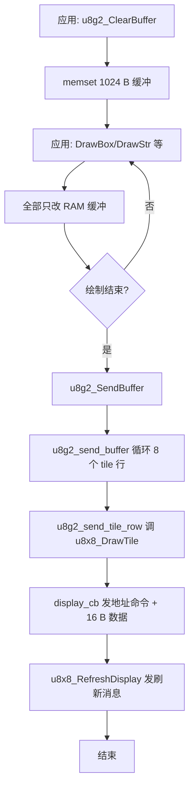
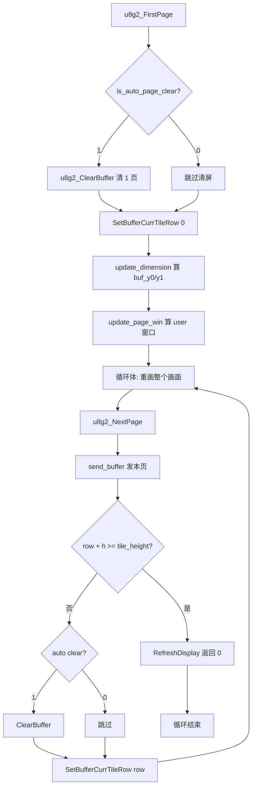

# u8g2 源码详解 01：内存与缓冲模型

> 涉及文件：
> - `csrc/u8g2_d_memory.c`（225 个静态缓冲分配函数，生成代码；2499 行）
> - `csrc/u8g2_buffer.c`（缓冲管理：Clear / FirstPage / NextPage / SendBuffer；305 行）
> - `csrc/u8g2_setup.c`（`u8g2_SetupBuffer` 中央装配；602 行）
> - `csrc/u8g2_d_setup.c`（1104 个装配函数，决定用哪种模式；10019 行）
> - `csrc/u8g2.h`（`u8g2_t` 中与缓冲相关的 13 个字段）
> - `csrc/u8x8_8x8.c`、`csrc/u8x8_display.c`（u8x8 无缓冲字符模式的落点）
>
> 关联章节：[00-总览与架构.md](00-总览与架构.md) |
> [02-绘制管线精读.md](02-绘制管线精读.md) |
> [03-显示控制器与通信.md](03-显示控制器与通信.md)

---

## 1. 三种模式一张表

u8g2 的"内存模式"不是一个运行时配置，而是**在编译期选函数名**决定的：`_1`、`_2`、`_f`
后缀直接对应三个不同的缓冲分配函数与三个不同的 `tile_buf_height`。

| 模式 | 后缀 | 分配函数（128x64 屏） | `tile_buf_height` | 128x64 RAM | 绘制能力 | 典型用途 |
|---|---|---|---|---|---|---|
| 全缓冲 | `_f` | `u8g2_m_16_8_f` | 8 | **1024 B** | 任意绘制，一次性提交 | 主推模式，≥1 KB RAM 的 MCU |
| 双页 | `_2` | `u8g2_m_16_8_2` | 2 | **256 B** | 分页绘制，页内可任意 | RAM 紧张但要图形 |
| 单页 | `_1` | `u8g2_m_16_8_1` | 1 | **128 B** | 分页绘制，页内可任意 | 2 KB SRAM 的 AVR |
| 无缓冲 | 无 | 不分配 | — | **0 B** | 只能 8x8 点阵字符 | u8x8 纯文本界面 |

三个数字的来历只有一条公式，`csrc/u8g2_buffer.c` L59-L62 把它写得很直白：

```c
  cnt = u8g2_GetU8x8(u8g2)->display_info->tile_width;	// 一"tile 行"的字节数 = 宽像素/8（128 宽 = 16）
  cnt *= u8g2->tile_buf_height;				// 缓冲的 tile 行数：页模式 1/2 行，全缓冲 = 满屏行数
  cnt *= 8;						// 每 tile 竖跨 8 像素行，即 8 字节
  memset(u8g2->tile_buf_ptr, 0, cnt);			// 典型 128x64 全缓冲：16*8*8 = 1024 字节
```

即 **缓冲字节数 = tile_width × tile_buf_height × 8**。128x64 屏 `tile_width=16`，
`_f` 时 `tile_buf_height=8` → 16×8×8 = 1024；`_1` 时 = 16×1×8 = 128。

## 2. tile 是全库的计量单位

`tile` 指 8x8 像素块，这是所有单色控制器的显存寻址粒度（SSD1306 的页、ST7920 的
16x16 字符块、MAX7219 的 8x8 模块都是它的变体）。两个尺寸字段定义在
`csrc/u8x8.h` 的 `u8x8_display_info_struct`（L285-L286）：

```c
  uint8_t tile_width;
  uint8_t tile_height;
```

以及像素尺寸（L297-L298）：

```c
  uint16_t pixel_width;
  uint16_t pixel_height;
```

注意 `pixel_width <= tile_width*8` 是硬约束（L294-L296 的注释）：128x64 屏 tile 是
16x8，像素正好 128x64；而 128x32 屏 tile 是 16x4，像素高 32。**像素尺寸可以小于
tile 尺寸×8，不能大于**——否则缓冲里根本没有对应的位。

这一层设计带来一个贯穿全库的约定：所有"行"的运算都以 tile 行为单位，
像素行号 `y` 与 tile 行号 `ty` 的关系恒为 `ty = y >> 3`、位偏移 `y & 7`。
`u8g2_buffer.c` 的 `u8g2_send_tile_row`（L76）与 `u8g2_WriteBufferPBM`
（L265）都直接吃这个约定。

## 3. 缓冲分配：225 个同模板函数

`csrc/u8g2_d_memory.c` 全文 2499 行、225 个函数，全部由 `tools/codebuild` 生成，
命名规则：

```text
u8g2_m_<tile_width>_<tile_height>_<mode>
             16            8          f
```

三种模式各 75 个（75 种常见 tile 尺寸），共 225。函数体是同一个模板，以
128x64 全缓冲为例（`csrc/u8g2_d_memory.c` L79-L89，逐字摘录）：

```c
uint8_t *u8g2_m_16_8_f(uint8_t *page_cnt)
{
  #ifdef U8G2_USE_DYNAMIC_ALLOC
  *page_cnt = 8;
  return 0;
  #else
  static uint8_t buf[1024];
  *page_cnt = 8;
  return buf;
  #endif
}
```

三个细节值得注意：

1. **`static` 数组**：缓冲不在栈上也不在堆上，而是编译期静态分配。链接器只保留被
   实际引用的那几个数组，所以"225 个函数"不会真的占 225 份 RAM。
2. **`page_cnt` 是输出参数**：它把 `tile_buf_height` 带回去，`u8g2_d_setup.c`
   里紧接着把它传给 `u8g2_SetupBuffer`。分配函数与装配函数的唯一耦合就是这个
   1 字节。
3. **`U8G2_USE_DYNAMIC_ALLOC` 分支返回 0**：此时所有分配函数都返回 NULL，
   用户必须自己调 `u8g2_SetBufferPtr`（`csrc/u8g2.h` L1927 的宏）：

```c
#define u8g2_SetBufferPtr(u8g2, buf) ((u8g2)->tile_buf_ptr = (buf));
```

这是把"静态数组"换成"外部 SRAM / 内存池"的唯一官方口子，`u8g2.h` L101 的
注释写死了前提：**用任何显示函数之前必须先绑定缓冲**，否则 `tile_buf_ptr == NULL`，
第一次 `ClearBuffer` 就写空指针。

## 4. 全缓冲模式：一次画完，一次发完

全缓冲的语义是"缓冲高度 = 屏幕高度"，于是页模式那套翻页逻辑退化为一次循环。
四条 API 的分工在 `csrc/u8g2_buffer.c`：

| 函数 | 行号 | 作用 |
|---|---|---|
| `u8g2_ClearBuffer` | L56 | 把整块缓冲 `memset` 为 0 |
| `u8g2_SendBuffer` | L134 | 逐 tile 行搬到显示 RAM + 刷新消息 |
| `u8g2_UpdateDisplay` | L250 | 同上但不发刷新（电子纸用） |
| `u8g2_UpdateDisplayArea` | L217 | 只发指定 tile 矩形（仅全缓冲） |

发送的核心是一个双层循环，`u8g2_send_buffer`（L105-L123）：

```c
  src_row = 0;
  src_max = u8g2->tile_buf_height;			// 缓冲高度（tile 行）
  dest_row = u8g2->tile_curr_row;			// 当前页起始行（FirstPage/NextPage 推进）
  dest_max = u8g2_GetU8x8(u8g2)->display_info->tile_height;	// 显示 RAM 总 tile 行数

  do
  {
    u8g2_send_tile_row(u8g2, src_row, dest_row);	// 缓冲第 src_row 行 → 显示第 dest_row 行
    src_row++;
    dest_row++;
  } while( src_row < src_max && dest_row < dest_max );	// 任一侧走完就停，天然处理非 8 倍数高度屏
```

`src_max == dest_max == 8` 时循环 8 次，每次发 16 字节（`u8g2_send_tile_row` L88 的
`u8x8_DrawTile(..., w, ptr)`）。所以全缓冲一次 `SendBuffer` 的总线事务数 = 8 条
DRAW_TILE 消息。

执行流如下（以 128x64 全缓冲为例）：



## 5. 页模式：用 1/8 RAM 换 8 倍绘制

`_1`/`_2` 模式的缓冲只装得下 1~2 个 tile 行，于是必须把"画一整屏"拆成
"画一页 → 发送 → 清屏 → 下一页"。这套循环由三个函数构成，全部在
`csrc/u8g2_buffer.c`：

| 函数 | 行号 | 职责 |
|---|---|---|
| `u8g2_FirstPage` | L164 | 清缓冲（若 auto clear）+ 页指针归零 |
| `u8g2_NextPage` | L180 | 发当前页 → 翻页 → 返回是否还有下一页 |
| `u8g2_SetBufferCurrTileRow` | L149 | 设页起点并重算裁剪窗口 |

标准用法（`u8g2_FirstPage` 的注释 L159-L162 给出的模板）：

```c
u8g2_FirstPage(&u8g2);
do {
  /* 每次循环都把整个画面重新画一遍 */
} while ( u8g2_NextPage(&u8g2) );
```

`u8g2_NextPage` 的返回语义是这套循环的关键（L180-L197）：

```c
  u8g2_send_buffer(u8g2);		// 当前页内容 → 显示 RAM（从 tile_curr_row 起共 tile_buf_height 行）
  row = u8g2->tile_curr_row;
  row += u8g2->tile_buf_height;		// 页指针前移一个缓冲高度
  if ( row >= u8g2_GetU8x8(u8g2)->display_info->tile_height )
  {
    u8x8_RefreshDisplay( u8g2_GetU8x8(u8g2) );	// 所有页发完：刷新（电子纸成像；其他屏多为空操作）
    return 0;				// 绘制循环结束
  }
```

注意顺序：**先发本页，再判断结束，再清屏翻页**。如果反过来先翻页再发送，
最后一页的 `row` 已经越界，发送循环会一行都发不出去。

页模式下"当前页"的纵向范围由 `u8g2_setup.c` 的 `u8g2_update_dimension_common`
（L188）计算，核心是两行（L205-L217）：

```c
  t = u8g2->tile_curr_row;
  t *= 8;
  u8g2->pixel_curr_row = t;		// 当前页首行对应的像素 y（页模式的窗口基点）
```

```c
  u8g2->buf_y0 = u8g2->pixel_curr_row;	// 本页缓冲覆盖的纵向区间 [buf_y0, buf_y1)
  u8g2->buf_y1 = u8g2->buf_y0;
  u8g2->buf_y1 += t;			// hvline 裁剪靠它：y 落在区间外直接丢弃
```

于是"页"这个概念在绘制层就变成了一个裁剪窗口：`R0` 的 `u8g2_update_page_win_r0`
（L284）把 `user_y0/user_y1` 设成 `buf_y0/buf_y1`，所有 `DrawXxx` 画到窗口外的部分
被 `u8g2_DrawHVLine` 直接丢掉（见 02 篇）。**这就是页模式不需要"知道屏幕在哪一页"
的原因——坐标系始终是全屏坐标，只有窗口在移动。**

执行流：



## 6. u8x8 无缓冲：0 字节也能量

`u8x8` 是纯字符设备：它不存位图，直接把"一个 8x8 字符块"翻译成控制器命令发走。
落点在 `csrc/u8x8_display.c` 的 `u8x8_DrawTile`（L82-L90）：

```c
uint8_t u8x8_DrawTile(u8x8_t *u8x8, uint8_t x, uint8_t y, uint8_t cnt, uint8_t *tile_ptr)
{
  u8x8_tile_t tile;
  tile.x_pos = x;
  tile.y_pos = y;
  tile.cnt = cnt;
  tile.tile_ptr = tile_ptr;
  return u8x8->display_cb(u8x8, U8X8_MSG_DISPLAY_DRAW_TILE, 1, (void *)&tile);
}
```

`tile_ptr` 在这里指向的是**调用者栈上的 8 字节字模**（`csrc/u8x8_8x8.c` 里
`u8x8_Draw8x8` 系列用局部 `buf[8]` 现拼），不是持久缓冲。所以 u8x8 模式的 RAM
开销是 0，代价是：

- 只能用 8x8 网格字体，没有任意字高；
- 没有帧缓冲 → 不能做"先擦后画"的图元叠加；
- 每次字符输出都是实时总线事务，闪烁与撕裂由控制器自己扛。

`u8x8_DrawString`（`csrc/u8x8_8x8.c` L389）就是"逐字符 → 查字模 → DrawTile"的
直通管道，没有任何缓冲层。

## 7. RAM 账本

数据从应用调用到屏幕像素的载体变化：


载体的字节数沿链路递减：**1024 B（整帧）→ 16 B（一个 tile 行）→ 1 B（总线字节）
→ 1 bit（显存位）**。每一级都能独立替换（换 buffer 大小、换 byte_cb），
这是 u8g2 能同时支持 0 缓冲与全缓冲的原因。

### 7.1 帧缓冲（静态数组，链接期确定）

| 屏 | tile 尺寸 | `_1` | `_2` | `_f` | 计算式（tile_width×8×n） |
|---|---|---|---|---|---|
| 128x64 | 16x8 | 128 B | 256 B | **1024 B** | 16×8×n，n=1/2/8 |
| 128x32 | 16x4 | 128 B | 256 B | 512 B | 16×8×n，n=1/2/4 |
| 64x48 | 8x6 | 64 B | 128 B | 384 B | 8×8×n，n=1/2/6 |
| 96x16 | 12x2 | 96 B | 192 B | 192 B | 12×8×n，n=1/2/2 |
| 256x64 | 32x8 | 256 B | 512 B | **2048 B** | 32×8×n，n=1/2/8 |

96x16 一行值得注意：`_2` 与 `_f` 都是 192 B，因为 `tile_height=2`，双页已经是满屏。
同理 `_1` 与 `_2` 在 `tile_height=1` 的屏上完全等价。

### 7.2 上下文 `u8g2_t`（栈/静态，取决于用户放置）

`u8g2_t` 的大小随三个编译开关浮动，主要项：

| 组成 | AVR（8 位，`U8G2_16BIT` 关） | 32 位 ARM（`U8G2_16BIT` 开） |
|---|---|---|
| `u8x8_t`（四回调 + 状态 + pins[22]） | 约 50 B | 约 68 B |
| 指针字段（ll_hvline/cb/tile_buf_ptr/font/font_calc_vref） | 5×2 = 10 B | 5×4 = 20 B |
| 坐标/尺寸 `u8g2_uint_t` 共 15 个 | 15×1 = 15 B | 15×2 = 30 B |
| `font_info`（23 字节字体头缓存） | 23 B | 23 B |
| `font_decode`（RLE 现场） | 约 12 B | 约 16 B |
| 杂项（颜色/模式/开关 8 个 uint8_t） | 8 B | 8 B |
| **合计（估算，不含对齐填充）** | **约 118 B** | **约 165 B** |

`u8g2_uint_t` 的定义在 `csrc/u8g2.h` L229-L234：

```c
#ifdef U8G2_16BIT
typedef uint16_t u8g2_uint_t;	/* for pixel position only */
```

```c
typedef uint8_t u8g2_uint_t;		/* for pixel position only */
```

且 L91-L94 强制"32 位环境必须开 16BIT"，因为 32 位指针下省这 15 字节没有意义，
反而把屏宽限制在 255 像素。

### 7.3 一笔总账（128x64 全缓冲 + AVR）

| 项 | 字节 |
|---|---|
| 帧缓冲 `buf[1024]` | 1024 |
| `u8g2_t` | ~118 |
| 字体（一个 6x10 字体） | 约 600~1000（在 flash，不占 RAM） |
| **RAM 合计** | **约 1142 B** |

ATmega328P 有 2048 B SRAM，所以 `_f` 能跑但要留神栈；`_1` 时降到约 246 B，
代价是每帧要执行 8 次完整重绘。

## 8. 陷阱与实测建议

1. **页模式循环体的绘制次数必须恒定**。`NextPage` 只在 `row` 推进时才翻页，
   如果某一页少画一笔，屏幕上会留下上一帧的残影（因为 auto clear 只清当前页缓冲，
   不清已经写进控制器的那一页）。实测症状是"菜单滚动时残影随页面跳动"。
2. **`is_auto_page_clear = 0` 是性能开关，不是省事开关**。关掉后
   `FirstPage`/`NextPage` 都不清屏，必须自己在合适时机 `ClearBuffer`，
   否则页与页之间会叠加。
3. **`u8g2_UpdateDisplayArea` 只在全缓冲模式有效**。L223-L224 有硬性守卫：

```c
  if ( u8g2->tile_buf_height != u8g2_GetU8x8(u8g2)->display_info->tile_height )
    return; /* not in full buffer mode, do nothing */	// 页模式缓冲与屏不同高，区域坐标对不上，直接放弃
```

   页模式下调用它**静默失败**（无返回值、无日志），这是最常见的"局部刷新不生效"原因。
4. **动态分配模式下 `u8g2_Setup_xxx` 返回的缓冲是 NULL**。`U8G2_USE_DYNAMIC_ALLOC`
   打开后，`u8g2_m_*` 全部 `return 0`，必须在 `Setup` 之后立刻
   `u8g2_SetBufferPtr(&u8g2, my_buf)`，且 `my_buf` 大小必须 ≥
   `tile_width × tile_buf_height × 8`。
5. **换了旋转，页模式的窗口语义也变**。`R1/R3` 下 `buf_y0/y1` 映射到 `user_x0/x1`
   （见 `u8g2_update_page_win_r1` L316-L319），所以"页"在用户坐标系里是竖着切的。
   写死 `user_y` 范围的绘制代码在旋转后会失效。

## 9. 读码路径

```text
第一站  csrc/u8g2_d_memory.c  u8g2_m_16_8_f（L79）      → 缓冲从哪来、多大
第二站  csrc/u8g2_setup.c     u8g2_SetupBuffer（L99）    → 三个字段如何被装上
第三站  csrc/u8g2_buffer.c    ClearBuffer（L56）         → 缓冲布局与 memset 尺寸
第四站  csrc/u8g2_buffer.c    FirstPage/NextPage（L164/L180）→ 页循环状态机
第五站  csrc/u8g2_setup.c     update_dimension_common（L188）→ 页窗口怎么算
```

配套 KB：[u8g2_buffer.md](../../../05-学习笔记与知识库/Knowledge-Base/u8g2/u8g2_buffer.md)、
[u8g2_d_memory.md](../../../05-学习笔记与知识库/Knowledge-Base/u8g2/u8g2_d_memory.md)、
[u8g2_setup.md](../../../05-学习笔记与知识库/Knowledge-Base/u8g2/u8g2_setup.md)。
