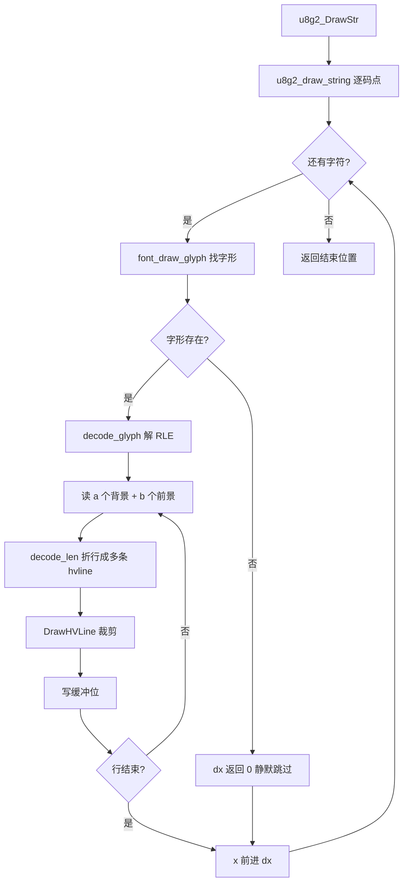

# u8g2 源码详解 02：绘制管线精读

> 涉及文件：
> - `csrc/u8g2_hvline.c`（`u8g2_DrawHVLine` 裁剪 + 方向归一化；265 行）
> - `csrc/u8g2_ll_hvline.c`（两种显存位序的最终写位；372 行）
> - `csrc/u8g2_setup.c`（`draw_l90` 旋转回调组 R0~R3/MIRROR；602 行）
> - `csrc/u8g2_intersection.c`（矩形相交预测试；176 行）
> - `csrc/u8g2_box.c`、`csrc/u8g2_circle.c`（上层图元如何拆成 hvline）
> - `csrc/u8g2_font.c`（RLE 字形解码到 hvline；2001 行）
> - `csrc/u8g2.h`（`u8g2_uint_t` / `u8g2_t` 的窗口字段）
>
> 关联章节：[00-总览与架构.md](00-总览与架构.md) |
> [01-内存与缓冲模型.md](01-内存与缓冲模型.md) |
> [03-显示控制器与通信.md](03-显示控制器与通信.md) |
> [10-字体引擎精读.md](10-字体引擎精读.md)

---

## 1. 五段流水线

从 `u8g2_DrawBox()` 到"某个字节的第 3 位置 1"，中间固定穿过五段。每一段都有明确的
输入输出契约，且**只有第 5 段知道显存布局**：

| 段 | 函数 | 文件:行 | 输入 | 输出 |
|---|---|---|---|---|
| 1 图元拆线 | `u8g2_DrawBox` 等 | `u8g2_box.c:65` | 矩形/圆参数 | 若干条 hvline 调用 |
| 2 裁剪 + 方向归一 | `u8g2_DrawHVLine` | `u8g2_hvline.c:160` | 任意 dir 0~3 | dir 只取 0/1 且已裁到窗口内 |
| 3 旋转 | `cb->draw_l90` | `u8g2_setup.c:407+` | 用户坐标 | 屏幕坐标 |
| 4 页偏移 | `u8g2_draw_hv_line_2dir` | `u8g2_hvline.c:142` | 屏幕坐标 y | 缓冲坐标 y |
| 5 写位 | `ll_hvline` | `u8g2_ll_hvline.c:72/245` | 缓冲坐标 | `tile_buf_ptr` 上的位操作 |

第 3、4 段的顺序容易记反：**先旋转（用户坐标 → 屏幕坐标），再减页偏移
（屏幕坐标 → 缓冲坐标）**。这在 `u8g2_DrawHVLine` 末尾的注释与
`u8g2_draw_hv_line_2dir` 的第一行代码里写得很清楚。

## 2. 第 1 段：图元只是"拆线器"

`u8g2_DrawBox`（`csrc/u8g2_box.c` L65）的全部逻辑就是"逐行发水平线"：

```c
void u8g2_DrawBox(u8g2_t *u8g2, u8g2_uint_t x, u8g2_uint_t y, u8g2_uint_t w, u8g2_uint_t h)
{
#ifdef U8G2_WITH_INTERSECTION
  if ( u8g2_IsIntersection(u8g2, x, y, x+w, y+h) == 0 ) 
    return;
#endif /* U8G2_WITH_INTERSECTION */
  while( h != 0 )
  { 
    u8g2_DrawHVLine(u8g2, x, y, w, 0);
    y++;    
    h--;
  }
}
```

两个设计点：

1. **矩形级预测试**：整个框先做一次 `IsIntersection`，框完全在窗口外时直接返回，
   省掉 `h` 次 hvline 调用。这是 `U8G2_WITH_INTERSECTION` 的典型用法——粗粒度
   判断放在图元层，细粒度裁剪放在 hvline 层。
2. **填充矩形 = h 条水平线**，不是 h×w 个像素。这是 u8g2 图元性能的根本：
   `DrawBox(0,0,128,64)` 只产生 64 次 hvline 调用，而不是 8192 次像素调用。

同理：`DrawFrame` 是 4 条线（`h>2` 时：上下两条 hline + 左右两条 vline；
`h==2` 时退化为上下 2 条 hline）；`DrawDisc` 的中点圆算法每步在 4 个象限各发
2 条竖线（`u8g2_DrawVLine`，共 8 条）；`DrawCircle` 每步发 8 次 `DrawPixel`
（每个像素仍然进 `DrawHVLine`，只是 `len=1`）。**没有一条图元会绕开
`DrawHVLine`。**

## 3. 第 2 段：`u8g2_DrawHVLine` 的三件事

### 3.1 先按 `is_page_clip_window_intersection` 短路

```c
#ifdef U8G2_WITH_CLIP_WINDOW_SUPPORT
  if ( u8g2->is_page_clip_window_intersection != 0 )
#endif /* U8G2_WITH_CLIP_WINDOW_SUPPORT */
    if ( len != 0 )
    {
```

（L166-L169）当用户用 `u8g2_SetClipWindow` 把窗口设到当前页之外时，
`u8g2_apply_clip_window`（`u8g2_setup.c:244`）把该标志置 0，**整页的所有绘制
在一次比较内被丢弃**。这是页模式 + 局部刷新场景的省电关键。

### 3.2 把 4 方向归一成 2 方向

`dir` 有 4 个值：0 右、1 下、2 左、3 上。后两者只是"起点在另一端"，所以先平移
起点，再把方向按位与成 0/1（L172-L186）：

```c
      /* convert to two directions */    
      if ( len > 1 )
      {
	if ( dir == 2 )
	{
	  x -= len;
	  x++;
	}
	else if ( dir == 3 )
	{
	  y -= len;
	  y++;
	}
      }
      dir &= 1;  
```

`len > 1` 的守卫很重要：`len == 1` 时 4 个方向画的都是同一个像素，平移会把它
挪到错误位置。`x -= len; x++;` 而不是 `x -= len - 1;`，是为了在 `u8g2_uint_t`
是无符号类型时不产生中间负值。

### 3.3 用窗口裁剪

```c
      /* clip against the user window */
      if ( dir == 0 )
      {
	if ( y < u8g2->user_y0 )
	  return;
	if ( y >= u8g2->user_y1 )
	  return;
	if ( u8g2_clip_intersection2(&x, &len, u8g2->user_x0, u8g2->user_x1) == 0 )
	  return;
      }
```

（L188-L197）水平线先在 y 上做两次比较（**垂直线在 x 上做同样的两次**，见
L198-L206），只有落在窗口内的那一维才进入一维区间求交。这个顺序让"整行不在窗口内"
的常见情况只花 2 次比较。

裁剪函数 `u8g2_clip_intersection2`（L71-L126）的契约是：

- 输入区间 `[a, a+len)`，窗口 `[c, d)`，两边上界都不含；
- 返回 0 表示无交集，返回 1 时**原地改写** `*ap` 与 `*len` 为交集。

摘录核心四行（L113-L124）：

```c
  if ( a >= d )
    return 0;
  if ( b <= c )
    return 0;
  if ( a < c )		
    a = c;
  if ( b > d )
    b = d;
```

**算例**：窗口 `[0,128)`，画 `x=120, len=20` 的水平线 →
`a=120, b=140`；`a>=d` 不成立，`b<=c` 不成立；`a<c` 不成立；`b>d` 成立 → `b=128`；
输出 `x=120, len=8`。右侧 12 个像素被裁掉。

L97-L109 还有一段处理 `a > b`（无符号回绕导致的"负长度"）的防御代码，作者注释
明确说"删掉它可能造成内存越界"——**不要以为这是死代码**。

## 4. 第 3 段：旋转是"换三个函数指针"

`u8g2->cb` 指向一张 3 个回调的表（`csrc/u8g2.h` 的 `struct u8g2_cb_struct`，
L346）。`DrawHVLine` 的最后一步就是调第三项：

```c
      u8g2->cb->draw_l90(u8g2, x, y, len, dir);
```

（L209）六个实现全部在 `csrc/u8g2_setup.c`：

| 回调 | 行号 | 变换 |
|---|---|---|
| `u8g2_draw_l90_r0` | L407 | 恒等，直接透传 |
| `u8g2_draw_l90_mirrorr_r0` | L420 | 水平镜像：`xx = width - x [- len 或 -1]` |
| `u8g2_draw_mirror_vertical_r0` | L440 | 垂直镜像：`yy = height - y [- len 或 -1]` |
| `u8g2_draw_l90_r1` | L463 | 顺时针 90°：`(x,y)` 换成 `(y, ...)` |
| `u8g2_draw_l90_r2` | L493 | 180°：双轴翻转 |
| `u8g2_draw_l90_r3` | L542 | 270°：`(x,y)` 换成 `(y, ...)` 的逆 |

R0 的实现只有一行有效代码（L412）：

```c
  u8g2_draw_hv_line_2dir(u8g2, x, y, len, dir);
```

水平镜像的取整逻辑值得单独看（L420-L434）：

```c
  xx = u8g2->width;
  xx -= x;
  if ( (dir & 1) == 0 )		// 水平线：线段整体翻转，起点平移一个长度
  {
    xx -= len;
  }
  else
  {
    xx--;			// 垂直线：单像素列，减 1 对齐到镜像位置
  }
```

**"线段整体翻转要减 len、单列只减 1"** 是所有镜像/旋转实现的共同陷阱：
一条从 `x` 开始、长 `len` 的线，镜像后起点是 `width-x-len`，不是 `width-x`。

## 5. 第 4 段：页偏移

```c
  /* clipping happens before the display rotation */

  /* transform to pixel buffer coordinates */
  y -= u8g2->pixel_curr_row;
  
  u8g2->ll_hvline(u8g2, x, y, len, dir);
```

（`csrc/u8g2_hvline.c` L145-L150）`pixel_curr_row = tile_curr_row × 8`
（`u8g2_setup.c:205-207`）。全缓冲时它恒为 0，这一行是空操作；页模式下它把
"屏幕第 40 行"换算成"本页缓冲第 8 行"。

**注意减法在无符号类型上的风险**：如果旋转回调给出的 `y < pixel_curr_row`
（例如 R2 的镜像把 y 翻到了页区间之外），这里会回绕成巨大的值。防线在
`DrawHVLine` 的窗口裁剪——`user_y0/y1` 已经把范围限制在本页内，所以进到这一行
的 `y` 一定 ≥ `pixel_curr_row`。

## 6. 第 5 段：两种显存位序

### 6.1 竖排字节：`u8g2_ll_hvline_vertical_top_lsb`

SSD1306/SH1106/UC1701 这一族的显存是"每字节 8 个纵向像素，LSB 在上"。
函数从 L72 开始，地址计算只有三行（L102-L107）：

```c
  offset = y;		/* y might be 8 or 16 bit, but we need 16 bit, so use a 16 bit variable */
  offset &= ~7;
  offset *= u8g2_GetU8x8(u8g2)->display_info->tile_width;
  ptr = u8g2->tile_buf_ptr;
  ptr += offset;
  ptr += x;
```

即 **字节地址 = (y & ~7) × tile_width + x**。`y & ~7` 是"tile 行号 × 8"，
乘 `tile_width` 得到该 tile 行的起始字节，再加列偏移 `x`。

位掩码来自 y 的低 3 位（L89-L92）：

```c
  bit_pos = y;		/* overflow truncate is ok here... */
  bit_pos &= 7; 	/* ... because only the lowest 3 bits are needed */
  mask = 1;
  mask <<= bit_pos;
```

写入用"或掩码 + 异或掩码"两个变量统一三种颜色（L94-L99）：

```c
  or_mask = 0;
  xor_mask = 0;
  if ( u8g2->draw_color <= 1 )
    or_mask  = mask;
  if ( u8g2->draw_color != 1 )
    xor_mask = mask;
```

真值表：

| `draw_color` | `or_mask` | `xor_mask` | 净效果 |
|---|---|---|---|
| 0（擦除） | mask | mask | `(b\|1)^1 = 0` → 清位 |
| 1（点亮） | mask | 0 | `(b\|1)^0 = 1` → 置位 |
| 2（XOR） | 0 | mask | `b^1` → 翻转 |

水平线走 `ptr++`（L109-L121），垂直线走"位号递增、跨 8 位时
`ptr += pixel_buf_width`"（L122-L152）。注意这里用的是 `pixel_buf_width`
（L139 的注释记录了 issue #148 的修复），不是 `width`——旋转后两者不同。

### 6.2 横排字节：`u8g2_ll_hvline_horizontal_right_lsb`

ST7920/T6963/MAX7219 这一族的显存是"每字节 8 个横向像素，MSB 在左"。
同一套逻辑换了三个常数（L253-L262）：

```c
  bit_pos = x;		/* overflow truncate is ok here... */
  bit_pos &= 7; 	/* ... because only the lowest 3 bits are needed */
  mask = 128;
  mask >>= bit_pos;

  offset = y;		/* y might be 8 or 16 bit, but we need 16 bit, so use a 16 bit variable */
  offset *= tile_width;
  offset += x>>3;
```

即 **字节地址 = y × tile_width + (x>>3)**，掩码从 0x80 右移。垂直线的步进是
`ptr += tile_width`（L295），因为下一行的同一列在"下一个字节"而不是"下一个位"。

两种位序的差异全部收敛在这两个函数里，`u8g2_d_setup.c` 的装配函数用
`u8g2_ll_hvline_vertical_top_lsb` / `u8g2_ll_hvline_horizontal_right_lsb`
作为第 4 个参数传进 `u8g2_SetupBuffer`（`u8g2_setup.c:99`）。

## 7. 相交预测试：`u8g2_IsIntersection`

用户级 API 在图元入口做粗筛，实现是一个 4 分支决策树（`u8g2_intersection.c:123`）：

```c
uint8_t u8g2_is_intersection_decision_tree(u8g2_uint_t a0, u8g2_uint_t a1, u8g2_uint_t v0, u8g2_uint_t v1)
{
  if ( v0 < a1 )		// v0 <= a1
  {
    if ( v1 > a0 )	// v1 >= a0
    {
      return 1;
    }
```

`u8g2_IsIntersection`（L166）先测 y 再测 x，任一维不相交就返回 0：

```c
  if ( u8g2_is_intersection_decision_tree(u8g2->user_y0, u8g2->user_y1, y0, y1) == 0 )
    return 0; 
  
  return u8g2_is_intersection_decision_tree(u8g2->user_x0, u8g2->user_x1, x0, x1);
```

上界不含（asymmetric boundaries），所以 `y0 == user_y1` 判为不相交。调用方传
`x+w`、`y+h` 正好符合这个语义。**代价**：一次图元调用多 2 次函数调用 + 4~8 次
比较，收益是页模式下整块图元被跳过。小图元（一个像素、一个字）开这个开关反而
更慢，这就是 `U8G2_WITH_INTERSECTION` 可裁剪的原因。

## 8. RLE 字体：从字符串到 hvline

字体路径比图元多两级"解码"，但最终仍然汇入 `DrawHVLine`。调用链：

```text
u8g2_DrawStr (font.c:1275)
  → u8g2_draw_string (font.c:1192)         逐字符取码点
    → u8g2_DrawGlyph / u8g2_font_draw_glyph (font.c:1051)
      → u8g2_font_get_glyph_data (font.c:952)    字形寻址
      → u8g2_font_decode_glyph (font.c:764)      解 RLE
        → u8g2_font_decode_len (font.c:509)      游程 → 一条 hvline
          → u8g2_DrawHVLine                       汇入主流水线
```

RLE 主循环（L845-L859，逐字摘录）：

```c
    for(;;)
    {
      a = u8g2_font_decode_get_unsigned_bits(decode, u8g2->font_info.bits_per_0);
      b = u8g2_font_decode_get_unsigned_bits(decode, u8g2->font_info.bits_per_1);
      // 一轮 = 一对游程：先 a 个背景（0）再 b 个前景（1）；
      // 紧随的 1 位为 1 表示同一行还有下一对 a/b，为 0 则进入下行
      do
      {
	u8g2_font_decode_len(u8g2, a, 0);
	u8g2_font_decode_len(u8g2, b, 1);
      } while( u8g2_font_decode_get_unsigned_bits(decode, 1) != 0 );

      if ( decode->y >= h )
	break;
    }
```

关键点：**"继续位"= 1 表示同一对 (a,b) 再画一遍**（压缩重复行），不是读新值。
每对游程的位宽 `bits_per_0` / `bits_per_1` 来自 23 字节字体头，不同字体可以不同。

`u8g2_font_decode_len`（L509）把一段游程按"字形右边界"折叠成若干条不跨行的
水平线：`rem = glyph_width - lx`（L533-L534），`current = min(rem, cnt)`
（L538-L540），画完推进 `lx`，到了右边界就换行。所以**一个游程最多产生
`ceil(len / glyph_width)` 条 hvline**，而不是 `len` 个像素调用。

字体头结构与 RLE 位流的完整解码见 [10-字体引擎精读.md](10-字体引擎精读.md)，
本篇只关心它在主流水线中的位置。

## 9. 数据流大图

```mermaid
flowchart LR
    APP["应用: DrawBox / DrawStr"] --> PRI["图元层: 拆成 hvline 序列"]
    PRI --> CLIP["DrawHVLine: 窗口裁剪 + 方向归一"]
    CLIP --> ROT["cb draw_l90: 用户坐标转屏幕坐标"]
    ROT --> PAGE["draw_hv_line_2dir: 减去 pixel_curr_row"]
    PAGE --> LL["ll_hvline: 字节地址 + 位掩码"]
    LL --> BUF["tile_buf_ptr 帧缓冲"]
    BUF --> SEND["send_buffer 逐 tile 行"]
    SEND --> DT["u8x8_DrawTile 消息"]
    DT --> CTRL["控制器 GDDRAM 点亮像素"]
```



同一次调用在任务视角下的展开（以一次 `DrawStr` 为例）：



## 10. 性能量化

以 128x64 全缓冲、`R0`、无裁剪窗口为例：

| 操作 | hvline 次数 | 写字节数 | 说明 |
|---|---|---|---|
| `DrawPixel` | 1 | 1 次读改写 | len=1，跳过方向归一 |
| `DrawHLine(0,y,128)` | 1 | 128 | `ptr++` 连续写 |
| `DrawVLine(x,0,64)` | 1 | 64 次读改写 + 8 次跨行 | 位号循环 |
| `DrawBox(0,0,128,64)` | 64 | 64×128 = 8192 | 每行一条 hline |
| `DrawFrame(0,0,128,64)` | 4 | 2×128 + 2×62 | 上下 + 左右 |
| `DrawStr`（6x10 字体，16 字符） | ≈ 16×(7~10) | 每条 ≤ 6 字节 | 取决于游程数 |

单次 `DrawPixel` 的固定开销：`DrawHVLine` 的 2 次窗口比较 + `IsIntersection`
（若开启）+ 1 次 `cb->draw_l90` 间接调用 + 1 次 `ll_hvline` 间接调用 ≈ 20~40 个
周期（AVR 16 MHz 下约 2~5 µs）。**所以 u8g2 的绘制成本几乎全在"每条线的固定
开销"上，而不是像素数**——这也是为什么"用 hline 填充"比"逐像素"快两个数量级。

## 11. 陷阱与实测建议

1. **`ll_hvline` 假设"裁剪已完成"**。`u8g2_ll_hvline.c` 的函数头注释写着
   `asumption: all clipping done`，它自己不做任何边界检查（`__unix` 下只有
   `assert`）。绕过 `DrawHVLine` 直接调 `ll_hvline` 会写坏相邻内存。
2. **`draw_color = 2` 是 XOR，不是"透明"**。透明是 `font_decode.is_transparent`
   与 `bitmap_transparency` 两个独立开关，别混。
3. **旋转后 `x/y/width/height` 全变**。`u8g2_draw_l90_r1` 做的是坐标变换，不是
   交换宽高——宽高交换发生在 `u8g2_update_dimension_r1`（`u8g2_setup.c:302`）。
   两处必须成对改，自己写旋转回调时最容易漏。
4. **镜像的 `-len` / `-1` 分支**。写自定义镜像时若统一减 len，垂直线会整体偏移
   `len-1` 个像素。
5. **字体的 `DrawGlyph` 会临时改 `draw_color`**，返回前恢复（`u8g2_font.c:862`）。
   在 `DrawGlyph` 前后读 `draw_color` 是正确的，但不要在解码回调里依赖它。

## 12. 读码路径

```text
第一站  csrc/u8g2_hvline.c    DrawHVLine（L160）        → 裁剪与方向归一
第二站  csrc/u8g2_hvline.c    clip_intersection2（L71） → 一维求交的边界语义
第三站  csrc/u8g2_setup.c     draw_l90_r0/r1（L407/L463）→ 旋转变换
第四站  csrc/u8g2_hvline.c    draw_hv_line_2dir（L142） → 页偏移
第五站  csrc/u8g2_ll_hvline.c vertical_top_lsb（L72）   → 位运算落盘
第六站  csrc/u8g2_font.c      decode_glyph（L764）      → RLE 如何汇入 hvline
```

配套 KB：[u8g2_buffer.md](../../../05-学习笔记与知识库/Knowledge-Base/u8g2/u8g2_buffer.md)、
[u8g2_h.md](../../../05-学习笔记与知识库/Knowledge-Base/u8g2/u8g2_h.md)、
[u8g2_font.md](../../../05-学习笔记与知识库/Knowledge-Base/u8g2/u8g2_font.md)。
