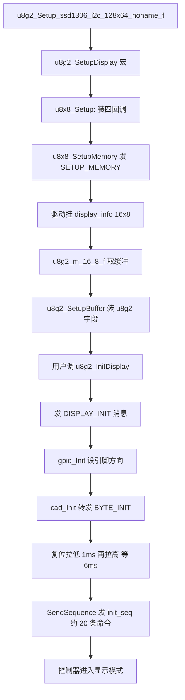
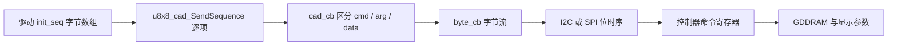

# u8g2 源码详解 03：显示控制器与通信

> 涉及文件：
> - `csrc/u8x8.h`（`u8x8_t` / `u8x8_display_info_t` / 全部消息号；1344 行）
> - `csrc/u8x8_setup.c`（`u8x8_Setup` / `u8x8_SetupDefaults`）
> - `csrc/u8x8_display.c`（`u8x8_DrawTile` / `u8x8_InitDisplay` 消息入口）
> - `csrc/u8x8_cad.c`（CAD 协议层 12 种实现；956 行）
> - `csrc/u8x8_byte.c`（字节层：软件 SPI/I2C、8080/6800 并口；673 行）
> - `csrc/u8x8_d_ssd1306_128x64_noname.c`（SSD1306/SH1106 驱动；544 行）
> - `csrc/u8g2_d_setup.c`（1104 个装配函数，决定 cad 与 ll_hvline 的组合）
>
> 关联章节：[00-总览与架构.md](00-总览与架构.md) |
> [01-内存与缓冲模型.md](01-内存与缓冲模型.md) |
> [02-绘制管线精读.md](02-绘制管线精读.md)

---

## 1. 四层回调栈

`u8x8_t`（`csrc/u8x8.h` L342-L372）里装着四个消息回调，这是整个通信层的全部抽象：

```c
struct u8x8_struct
{
  const u8x8_display_info_t *display_info;
  u8x8_char_cb next_cb; /*  procedure, which will be used to get the next char from the string */
  u8x8_msg_cb display_cb;
  u8x8_msg_cb cad_cb;
  u8x8_msg_cb byte_cb;
  u8x8_msg_cb gpio_and_delay_cb;
```

| 层 | 回调 | 只关心 | 典型实现 | 是否用户移植 |
|---|---|---|---|---|
| 显示驱动 | `display_cb` | 控制器命令语义（初始化、设页、写显存） | `u8x8_d_ssd1306_128x64_noname` | 否 |
| CAD 协议 | `cad_cb` | 命令/参数/数据三者的包装（DC 电平或 I2C 控制字节） | `u8x8_cad_001`、`u8x8_cad_ssd13xx_fast_i2c` | 否 |
| 字节传输 | `byte_cb` | 一个字节怎么发（SPI 时序、I2C 起停） | `u8x8_byte_4wire_sw_spi`、`u8x8_byte_sw_i2c` | **是** |
| GPIO/延时 | `gpio_and_delay_cb` | 拉脚、读脚、纳秒/毫秒延时 | Arduino/STM32 各自的实现 | **是** |

**移植工作只需要实现后两层**（`csrc/` 里已经有 6 种现成的 byte 实现可抄），
200+ 种控制器的差异全部被前两层吸收。

## 2. 消息号：一张整数总表

所有交互都是"回调 + 消息号 + 一个整数 + 一个指针"的四元组。消息号定义在
`csrc/u8x8.h`，分四组：

| 组 | 消息 | 值 | 携带内容 |
|---|---|---|---|
| DISPLAY | `SETUP_MEMORY` | 9 | 无（驱动内挂 display_info） |
| DISPLAY | `INIT` | 10 | 无（驱动内发初始化序列） |
| DISPLAY | `SET_POWER_SAVE` | 11 | `arg_int` 0=开 1=关 |
| DISPLAY | `SET_FLIP_MODE` | 13 | `arg_int` 0/1 |
| DISPLAY | `SET_CONTRAST` | 14 | `arg_int` 0~255 |
| DISPLAY | `DRAW_TILE` | 15 | `arg_ptr` → `u8x8_tile_t` |
| DISPLAY | `REFRESH` | 16 | 无（电子纸用） |
| CAD | `INIT` | 20 | 透传给 byte 层 |
| CAD | `SEND_CMD` | 21 | `arg_int` = 命令字节 |
| CAD | `SEND_ARG` | 22 | `arg_int` = 参数字节 |
| CAD | `SEND_DATA` | 23 | `arg_int` = 字节数，`arg_ptr` = 数据 |
| CAD | `START_TRANSFER` | 24 | 无 |
| CAD | `END_TRANSFER` | 25 | 无 |
| BYTE | `INIT` | 20 | 与 CAD_INIT 同值（故意复用） |
| BYTE | `SET_DC` | 32 | `arg_int` = DC 电平 |
| BYTE | `SEND` | 23 | 与 CAD_SEND_DATA 同值（故意复用） |
| BYTE | `START/END_TRANSFER` | 24/25 | 与 CAD 同值（故意复用） |
| GPIO | `AND_DELAY_INIT` | 40 | 无 |
| GPIO | `DELAY_MILLI/10MICRO/100NANO/NANO` | 41~44 | `arg_int` = 延时量 |

**"同值复用"是设计而非巧合**：`U8X8_MSG_BYTE_INIT` 直接定义成
`U8X8_MSG_CAD_INIT`（L678），所以 `cad` 层收到 INIT 时可以原样转发给 `byte_cb`，
不用做任何翻译。这也是 `u8x8_cad_001` 里那几个 `case` 可以"fall through"到
`byte_cb` 的原因。

## 3. 命令是怎么被编码的：`U8X8_C` / `U8X8_A` / `U8X8_D1`

驱动里的初始化序列不是函数调用，而是一个 `uint8_t` 数组，用宏把"消息号 + 参数"
交替拼进去（`csrc/u8x8.h` L638-L646）：

```c
#define U8X8_C(c0)				(U8X8_MSG_CAD_SEND_CMD), (c0)
#define U8X8_A(a0)				(U8X8_MSG_CAD_SEND_ARG), (a0)
#define U8X8_CA(c0,a0)			(U8X8_MSG_CAD_SEND_CMD), (c0), (U8X8_MSG_CAD_SEND_ARG), (a0)
#define U8X8_CAA(c0,a0,a1)		(U8X8_MSG_CAD_SEND_CMD), (c0), (U8X8_MSG_CAD_SEND_ARG), (a0), (U8X8_MSG_CAD_SEND_ARG), (a1)
#define U8X8_D1(d0)			(U8X8_MSG_CAD_SEND_DATA), (d0)
```

SSD1306 的初始化序列就是这样写的（`csrc/u8x8_d_ssd1306_128x64_noname.c` L42-L75，
节选）：

```c
  U8X8_START_TRANSFER(),             	/* enable chip, delay is part of the transfer start */
  
  
  U8X8_C(0x0ae),		                /* display off */
  U8X8_CA(0x0d5, 0x080),		/* clock divide ratio (0x00=1) and oscillator frequency (0x8) */
  U8X8_CA(0x0a8, 0x03f),		/* multiplex ratio */
```

`u8x8_cad_SendSequence` 逐字节读数组：读到 21 就把它后面那个字节当命令发，
读到 22 就当参数发。**这就是"驱动即数据"** —— 加一个新控制器，多数情况只是抄一份
命令数组 + 一份 display_info，不需要写 C 逻辑。

## 4. 初始化消息链

`u8x8_Setup`（`csrc/u8x8_setup.c` L133-L147）只做三件事：

```c
void u8x8_Setup(u8x8_t *u8x8, u8x8_msg_cb display_cb, u8x8_msg_cb cad_cb, u8x8_msg_cb byte_cb, u8x8_msg_cb gpio_and_delay_cb)
{
  /* setup defaults and reset pins to U8X8_PIN_NONE */
  u8x8_SetupDefaults(u8x8);

  /* setup specific callbacks */
  u8x8->display_cb = display_cb;
  u8x8->cad_cb = cad_cb;
  u8x8->byte_cb = byte_cb;
  u8x8->gpio_and_delay_cb = gpio_and_delay_cb;

  /* setup display info */
  u8x8_SetupMemory(u8x8);
}
```

`u8x8_SetupMemory`（`csrc/u8x8_display.c` L93）发 `SETUP_MEMORY` 消息，驱动在
处理函数里调 `u8x8_d_helper_display_setup_memory` 把 `display_info` 挂上。
**注意此时还没有任何总线动作**——这一步是纯内存赋值。

真正的硬件动作在 `u8x8_InitDisplay`（L135）：

```c
void u8x8_InitDisplay(u8x8_t *u8x8)
{
  u8x8->display_cb(u8x8, U8X8_MSG_DISPLAY_INIT, 0, NULL);       /* this will call u8x8_d_helper_display_init() and send the init seqence to the display */
```

驱动收到 INIT 后调 `u8x8_d_helper_display_init`（L64-L79），它按固定顺序做三件事：

```c
      u8x8_gpio_Init(u8x8);             /* macro, which calls gpio_and_delay_cb with U8X8_MSG_GPIO_AND_DELAY_INIT */
      u8x8_cad_Init(u8x8);              /* this will also call U8X8_MSG_BYTE_INIT, byte init will NOT call GPIO_INIT */

      /* 3) do reset */
      u8x8_gpio_SetReset(u8x8, 1);
```

即 **GPIO 初始化 → 总线初始化（含 I2C 地址默认值）→ 硬复位时序 → 发送初始化序列**。
复位时序由 `display_info` 的三个字段控制：`reset_pulse_width_ms`（低电平宽度）、
`post_reset_wait_ms`（释放后等待），典型值 1 ms + 6 ms。

执行流：



## 5. CAD 层：三种典型实现

CAD = Command / Argument / Data。这一层要解决的唯一问题是"命令和数据在物理上怎么区分"。

### 5.1 `u8x8_cad_001`：用 DC 引脚区分

```c
uint8_t u8x8_cad_001(u8x8_t *u8x8, uint8_t msg, uint8_t arg_int, void *arg_ptr)
{
  switch(msg)
  {
    case U8X8_MSG_CAD_SEND_CMD:
      u8x8_byte_SetDC(u8x8, 0);
      u8x8_byte_SendByte(u8x8, arg_int);
      break;
    case U8X8_MSG_CAD_SEND_ARG:
      u8x8_byte_SetDC(u8x8, 0);
      u8x8_byte_SendByte(u8x8, arg_int);
      break;
    case U8X8_MSG_CAD_SEND_DATA:
      u8x8_byte_SetDC(u8x8, 1);
```

（`csrc/u8x8_cad.c` L340-L353）**命令和参数都是 DC=0，只有数据是 DC=1**。
这就是 SPI 屏的 4 线接法：CS、SCK、MOSI、DC。`cad_001` 适用于 SSD1306/ST7565/
UC1701 等绝大多数 SPI 控制器。

### 5.2 `u8x8_cad_ssd13xx_i2c`：每条命令独立事务

I2C 没有 DC 引脚，用"控制字节"代替：`0x00` = 后面跟命令，`0x40` = 后面跟数据。
经典版把每条命令/参数都包成一次独立的 START-STOP（L489-L503）：

```c
    case U8X8_MSG_CAD_SEND_CMD:
    case U8X8_MSG_CAD_SEND_ARG:
      /* 7 Nov 2016: Can this be improved?  */
      //u8x8_byte_SetDC(u8x8, 0);
      u8x8_byte_StartTransfer(u8x8);
      //u8x8_byte_SendByte(u8x8, u8x8_GetI2CAddress(u8x8));
      u8x8_byte_SendByte(u8x8, 0x000);
      u8x8_byte_SendByte(u8x8, arg_int);
      u8x8_byte_EndTransfer(u8x8);      
      break;
```

三条命令 = 三次 START + 9 个字节，I2C 开销约 3 倍。

### 5.3 `u8x8_cad_ssd13xx_fast_i2c`：命令合并进同一事务

`u8g2_Setup_ssd1306_i2c_128x64_noname_f` 实际用的是这个（`u8g2_d_setup.c` L387-L394）：

```c
  u8g2_SetupDisplay(u8g2, u8x8_d_ssd1306_128x64_noname, u8x8_cad_ssd13xx_fast_i2c, byte_cb, gpio_and_delay_cb);
  buf = u8g2_m_16_8_f(&tile_buf_height);
  u8g2_SetupBuffer(u8g2, buf, tile_buf_height, u8g2_ll_hvline_vertical_top_lsb, rotation);
```

它用一个 `static uint8_t in_transfer` 记住"事务是否开着"，命令与参数连续发、
只在数据段或显式 END 时收尾（`csrc/u8x8_cad.c` L586-L602）：

```c
    case U8X8_MSG_CAD_SEND_CMD:
      /* improved version, takeover from ld7032 */
      /* assumes, that the args of a command is not longer than 31 bytes */
      /* speed improvement is about 4% compared to the classic version */
      if ( in_transfer != 0 )
	 u8x8_byte_EndTransfer(u8x8); 
      
      u8x8_byte_StartTransfer(u8x8);
      u8x8_byte_SendByte(u8x8, 0x000);	/* cmd byte for ssd13xx controller */
      u8x8_byte_SendByte(u8x8, arg_int);
      in_transfer = 1;
```

作者注释给了量化：**比经典版快约 4%**（整屏刷新口径）。另一个"lightning"版本注释
说快 6%，但因为要求整个初始化序列塞进 Arduino Wire 的 32 字节缓冲而没启用。

### 5.4 其他 CAD 一览

| CAD | 行号 | 适用 | 区分方式 |
|---|---|---|---|
| `u8x8_cad_001` | L340 | SPI/并口通用 | 命令/参数 DC=0，数据 DC=1 |
| `u8x8_cad_011` | L372 | SSD1606 等 | 命令 DC=0，参数/数据 DC=1 |
| `u8x8_cad_110` | L229 | 特殊控制器 | 命令/参数 DC=1，数据 DC=0 |
| `u8x8_cad_100` | L308 | T6963 | 命令 DC=1，参数/数据 DC=0 |
| `u8x8_cad_st7920_spi` | L401 | ST7920 | 每字节前插两个同步位 |
| `u8x8_cad_ssd13xx_i2c` | L489 | SSD1306 I2C | 控制字节 0x00/0x40 |
| `u8x8_cad_ssd13xx_fast_i2c` | L586 | SSD1306 I2C 加速 | 合并事务 |
| `u8x8_cad_uc16xx_i2c` | L768 | UC1610 等 | DC 位编进地址字节 |
| `u8x8_cad_empty` | L202 | MAX7219 | 全部原样透传 |

## 6. 字节层：I2C 与 SPI 的位级时序

### 6.1 软件 I2C：`u8x8_byte_sw_i2c`

`csrc/u8x8_byte.c` L584-L625 的骨架：

```c
    case U8X8_MSG_BYTE_SEND:
      data = (uint8_t *)arg_ptr;
    
      while( arg_int > 0 )
      {
	i2c_write_byte(u8x8, *data);
	data++;
	arg_int--;
      }
      
      break;
      
    case U8X8_MSG_BYTE_INIT:
      i2c_init(u8x8);
      break;
    case U8X8_MSG_BYTE_SET_DC:
      break;
    case U8X8_MSG_BYTE_START_TRANSFER:
      i2c_start(u8x8);
      i2c_write_byte(u8x8, u8x8_GetI2CAddress(u8x8));
```

一次 SSD1306 数据段的总线字节序：

```text
START | 0x78 (写地址) | 0x40 (数据控制字节) | D0 D1 ... Dn | STOP
```

默认地址 `0x78` 来自 `u8x8_cad_ssd13xx_fast_i2c` 的 INIT 分支（L641-L644）：

```c
      if ( u8x8->i2c_address == 255 )
	u8x8->i2c_address = 0x078;
```

`i2c_address` 初值 255 表示"未设置"，所以**用户必须在 Setup 之后、InitDisplay 之前
用 `u8x8_SetI2CAddress` 改地址**；否则会拿到 0x78。

数据段还有一个硬约束：**单次传输不超过 24 字节**（L630-L636）：

```c
       while( arg_int > 24 )
      {
	u8x8_i2c_data_transfer(u8x8, 24, p);
	arg_int-=24;
	p+=24;
      }
```

原因是 Arduino `Wire` 的 32 字节缓冲——16 字节的数据段正好安全，而 32 字节宽的屏
（`tile_width=32`）一次 DRAW_TILE 要发 32 字节，会被自动拆成 24+8 两笔。

### 6.2 软件 SPI：`u8x8_byte_4wire_sw_spi`

`csrc/u8x8_byte.c` L113-L150 的位循环：

```c
	for( i = 0; i < 8; i++ )
	{
	  if ( b & 128 )
	    u8x8_gpio_SetSPIData(u8x8, 1);
	  else
	    u8x8_gpio_SetSPIData(u8x8, 0);
	  b <<= 1;
	  
	  u8x8_gpio_SetSPIClock(u8x8, not_takeover_edge);
	  u8x8_gpio_Delay(u8x8, U8X8_MSG_DELAY_NANO, u8x8->display_info->sda_setup_time_ns);
	  u8x8_gpio_SetSPIClock(u8x8, takeover_edge);
	  u8x8_gpio_Delay(u8x8, U8X8_MSG_DELAY_NANO, u8x8->display_info->sck_pulse_width_ns);
	}    
```

**MSB first**：`b & 128` 取最高位，然后左移。每个 bit 的时序是
"放数据 → 时钟到非采样沿 → 等 `sda_setup_time_ns` → 时钟到采样沿 → 等
`sck_pulse_width_ns`"。这两个延时来自 `display_info`（`u8x8.h` L254/L258），
典型值 12 ns / 50 ns——远小于一次 GPIO 函数调用的开销，所以**软件 SPI 的实际
速率由 `gpio_and_delay_cb` 的实现决定**，与这两个数关系不大。

`u8x8_byte_8bit_6800mode` / `8080mode`（L172/L222）是并口版本：一次 `SendByte`
就是把 8 位数据线 + 一个 WR 脉冲，没有位循环。

### 6.3 一次 DRAW_TILE 的完整字节序

SSD1306 的 DRAW_TILE 分支（`csrc/u8x8_d_ssd1306_128x64_noname.c` L297-L328）：

```c
    case U8X8_MSG_DISPLAY_DRAW_TILE:
      u8x8_cad_StartTransfer(u8x8);
      x = ((u8x8_tile_t *)arg_ptr)->x_pos;    
      x *= 8;
      x += u8x8->x_offset;
    
      u8x8_cad_SendCmd(u8x8, 0x040 );	/* set line offset to 0 */
    
      u8x8_cad_SendCmd(u8x8, 0x010 | (x>>4) );
      u8x8_cad_SendArg(u8x8, 0x000 | ((x&15)));					/* probably wrong, should be SendCmd */
      u8x8_cad_SendArg(u8x8, 0x0b0 | (((u8x8_tile_t *)arg_ptr)->y_pos));	/* probably wrong, should be SendCmd */

    
      do
      {
	c = ((u8x8_tile_t *)arg_ptr)->cnt;
	ptr = ((u8x8_tile_t *)arg_ptr)->tile_ptr;
	u8x8_cad_SendData(u8x8, c*8, ptr); 	/* note: SendData can not handle more than 255 bytes */
```

`0x10 | (x>>4)` 与 `0x00 | (x&15)` 合起来是"设置列地址低 4 位/高 4 位"（SSD1306
的 `0x10~0x1F` 与 `0x00~0x0F` 双命令写法）；`0xB0 | y_pos` 是"设置页地址"。
**注意 `x += u8x8->x_offset` 这一行**：SH1106 的显存是 132 列，可视区从第 2 列开始，
所以它的 `display_info.default_x_offset = 2`（同文件 L473），而 SSD1306 是 0（L353）。
同一份驱动代码靠这一个字段兼容两种屏。

## 7. 常见控制器差异表

一条命令从数组到控制器寄存器的载体变化：



`init_seq` 里每个字节前面都插了消息号（21/22/23），所以"命令数组"其实是
**消息流**；`cad_cb` 消费掉消息号，`byte_cb` 只看到纯字节。

| 控制器 | 显存位序 | `ll_hvline` | 典型 `cad_cb` | tile | 特殊点 |
|---|---|---|---|---|---|
| SSD1306 | 竖排 LSB 上 | `vertical_top_lsb` | `cad_001`（SPI）/ `fast_i2c` | 16x8 | 列地址双命令写法 |
| SH1106 | 竖排 | `vertical_top_lsb` | 同上 | 16x8 | **132 列，x_offset=2** |
| SSD1305 | 竖排 | `vertical_top_lsb` | `ssd13xx_i2c` | 16x4 | x_offset=2（部分型号） |
| ST7565 | 竖排 | `vertical_top_lsb` | `cad_001` | 16x8 | 复位极性因模块而异 |
| UC1701 | 竖排 | `vertical_top_lsb` | `cad_001` | 16x8 | 对比度寄存器 0~63 |
| ST7920 | **横排 MSB 左** | `horizontal_right_lsb` | `cad_001`（并口）/ `st7920_spi` | 16x8 | 串行模式每字节前插同步位 |
| T6963 | 横排 | `horizontal_right_lsb` | `cad_001` | 16x8 | 有独立"状态查询" |
| MAX7219 | 横排 | `horizontal_right_lsb` | `cad_empty` | 随模块（4x1 等） | 无读回，只能整块重写 |
| SSD1606 | 竖排 | `vertical_top_lsb` | `cad_011` | 22x9 | **电子纸，必须 REFRESH** |

这张表的每一行都能在 `csrc/u8g2_d_setup.c` 里找到对应的装配函数验证，例如
ST7920 串行版（L3923-L3930）：

```c
  u8g2_SetupDisplay(u8g2, u8x8_d_st7920_128x64, u8x8_cad_st7920_spi, byte_cb, gpio_and_delay_cb);
  buf = u8g2_m_16_8_f(&tile_buf_height);
  u8g2_SetupBuffer(u8g2, buf, tile_buf_height, u8g2_ll_hvline_horizontal_right_lsb, rotation);
```

## 8. 时序量化：128x64 一帧要多久

一帧 = 1024 字节数据 + 每 tile 行的寻址命令。以 8 个 tile 行为例：

### 8.1 I2C（`fast_i2c`，400 kHz）

每 tile 行的事务：`START + 0x78 + 0x40 + 16 数据 + STOP`。

| 项 | 位数 |
|---|---|
| 地址字节 | 9（含 ACK） |
| 控制字节 0x40 | 9 |
| 16 个数据字节 | 144 |
| START + STOP | 约 2 个位时 |
| **小计** | **约 164 位** |

`164 bit ÷ 400 kHz = 410 µs/行`，×8 行 = **约 3.3 ms/帧**。
100 kHz 时线性放大到 **约 13.1 ms/帧**，即 76 fps 上限。

### 8.2 SPI（`4wire_sw_spi`，4 MHz 理论）

每 tile 行：4 个命令/参数字节 + 16 个数据字节 = 20 字节 = 160 位。

`160 bit ÷ 4 MHz = 40 µs/行`，×8 行 = **约 0.32 ms/帧**（640 fps 理论上限）。

但软件 SPI 每个 bit 要 2 次 GPIO 写 + 2 次延时函数调用，在 16 MHz AVR 上实测
单 bit 约 1~2 µs，即实际速率 0.5~1 MHz → **1.3~2.6 ms/帧**。想跑到 4 MHz 必须
换硬件 SPI 的 `byte_cb`（`sys/` 下各平台移植例子里有现成实现）。

### 8.3 结论

| 接口 | 一帧耗时（128x64） | 上限帧率 | 瓶颈 |
|---|---|---|---|
| 软件 I2C 100 kHz | ~13 ms | ~76 fps | 总线位数 |
| 软件 I2C 400 kHz | ~3.3 ms | ~300 fps | 总线位数 |
| 软件 SPI | ~1.3~2.6 ms | ~380~770 fps | GPIO 函数调用 |
| 硬件 SPI 4 MHz | ~0.32 ms | ~3000 fps | 总线位数 |

实际应用里 30 fps 就够，所以 **I2C 100 kHz 也能跑动画**，这是 u8g2 在 Arduino
上体验尚可的原因。

## 9. 陷阱与实测建议

1. **I2C 地址默认 0x78，且只在 INIT 时设置一次**。0.96 寸模块常见 0x78 或 0x7A，
   买回来不显示的第二种原因（第一种是没上拉电阻）就是地址不对。
2. **SH1106 不是 SSD1306**。两者命令集几乎一样，但 SH1106 有 132 列显存，
   用 SSD1306 驱动会在右侧缺 2 列/整体偏移。正确做法是换
   `u8g2_Setup_sh1106_*`，它内部只是换了 `default_x_offset=2` 与初始化序列
   （`csrc/u8x8_d_ssd1306_128x64_noname.c` L473/L479）。
3. **`u8x8_cad_SendData` 一包不能超过 255 字节**（驱动注释明确写了）。256 宽全缓冲
   一行是 32 字节，安全；但自定义大屏驱动时要注意 `cnt*8` 的溢出。
4. **电子纸必须 REFRESH**。`SendBuffer` 末尾的 `u8x8_RefreshDisplay` 对普通 OLED
   是空操作，对 SSD1606 是数百毫秒的整屏刷新——高频调用会明显卡顿。
5. **软件 SPI 的 `gpio_and_delay_cb` 里不要用 `delay()`**。`U8X8_MSG_DELAY_NANO`
   每次位翻转都调，用毫秒级延时函数会把帧率打到 1 fps 以下；正确做法是空实现或
   用 `_delay_loop_1` 之类的周期级延时。
6. **并口 8080/6800 的 `byte_cb` 需要 8 根数据线 + 3 根控制线**，`gpio_and_delay_cb`
   要按 `U8X8_PIN_D0..D7` 逐个实现，不是"一个函数拉一根线"那么简单。

## 10. 读码路径

```text
第一站  csrc/u8x8.h          消息号表（L450~L534）        → 四元组协议
第二站  csrc/u8x8_setup.c    u8x8_Setup（L133）           → 四回调如何装上
第三站  csrc/u8x8_display.c  u8x8_DrawTile（L82）         → tile 消息的封装
第四站  csrc/u8x8_cad.c      cad_001（L340）/ fast_i2c（L586）→ 命令与数据的区分
第五站  csrc/u8x8_byte.c     sw_i2c（L584）/ 4wire_spi（L113）→ 位级时序
第六站  csrc/u8x8_d_ssd1306_128x64_noname.c  DRAW_TILE（L297）→ 控制器命令落地
```

配套 KB：[u8g2_d_setup.md](../../../05-学习笔记与知识库/Knowledge-Base/u8g2/u8g2_d_setup.md)、
[u8g2_h.md](../../../05-学习笔记与知识库/Knowledge-Base/u8g2/u8g2_h.md)。
