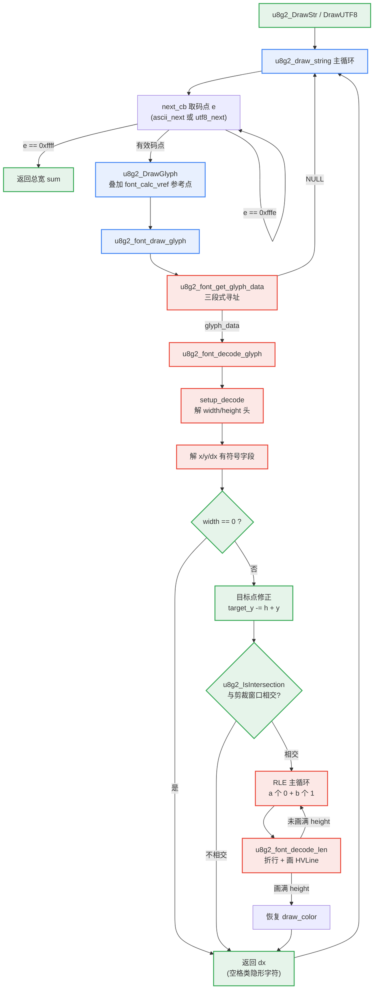
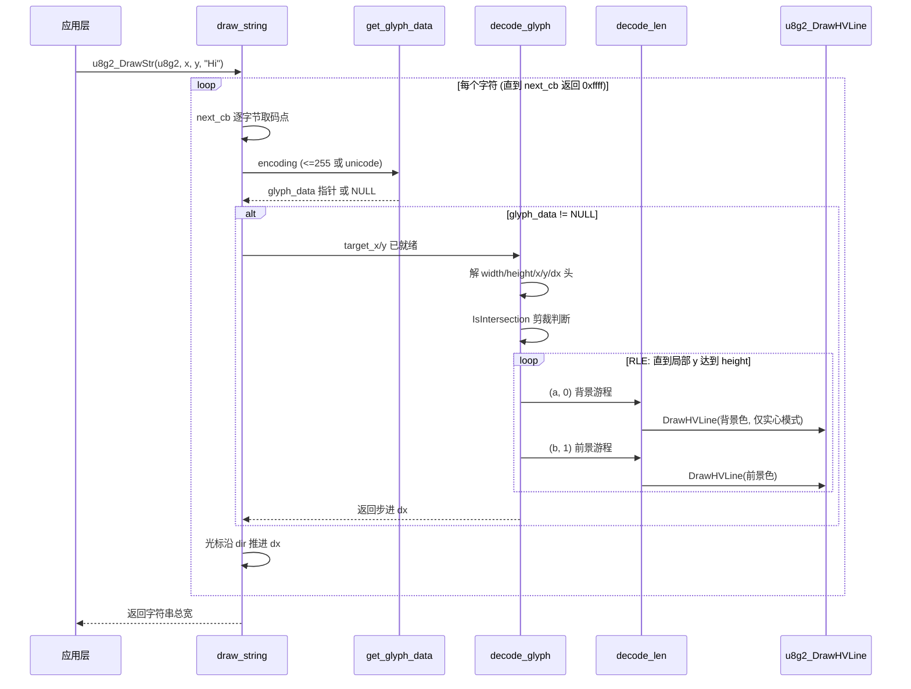
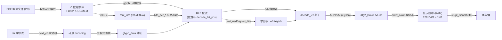

# u8g2 源码详解 10：字体引擎精读

> 涉及文件：
> - `csrc/u8g2_font.c`（2001 行，含中文深注）—— 字体解码渲染全实现，本篇主角
> - `csrc/u8g2.h`（231~290 行）—— `u8g2_font_info_t` / `u8g2_font_decode_t` 结构定义
> - `tools/font/build/` 与 `tools/font/bdfconv/` —— BDF 字体编译器（PC 端离线工具）
> - `csrc/u8x8utf8.c`（UTF-8 状态机回调，被 next_cb 引用）
> - `csrc/u8g2_kerning.c`（字距表，DrawExtendedUTF8 使用）
>
> 姊妹篇：[11-图元绘制算法.md](11-图元绘制算法.md)（几何图元）
> KB 条目：[clib_u8g2_font.md](../../05-学习笔记与知识库/Knowledge-Base/u8g2/clib_u8g2_font.md)

---

## 1. 全景：字体引擎在 u8g2 里的位置

u8g2 的字库是**编译期生成的 RLE 压缩位图数组**：PC 上用 `bdfconv` 把 BDF 字体文件
编译成 C 数组（如 `u8g2_font_6x10_tf`），MCU 端只做"寻址 + 解码 + 画点"三件事。
整个引擎没有 malloc、没有文件系统、没有浮点，全部开销是：

| 资源 | 用量 | 说明 |
|---|---|---|
| Flash（字体数据） | 每字形约 5~15 字节（ASCII 小字体） | 23 字节头 + 各 glyph 压缩数据 |
| RAM（元信息缓存） | `u8g2_font_info_t` 约 23~25 字节 | `u8g2_SetFont()` 时从 Flash 读出 |
| RAM（解码状态机） | `u8g2_font_decode_t` 约 12~14 字节 | 嵌在 `u8g2_t` 里，全局唯一 |
| 运行时开销 | 解一个字形 = O(字形位图位数) | 只按需解码当前字符，不解整库 |

`csrc/u8g2_font.c` 的函数分四层，自底向上：

| 层 | 函数（当前行号） | 职责 |
|---|---|---|
| L1 字节访问 | `u8g2_font_get_byte`(:130) / `u8g2_font_get_word`(:146) | Flash 安全读 1B/2B（大端） |
| L2 元信息 | `u8g2_read_font_info`(:165) / `u8g2_GetFontSize`(:214) | 解析 23 字节字体头 |
| L3 位流解码 | `get_unsigned_bits`(:319) / `get_signed_bits`(:375) / `decode_len`(:509) / `setup_decode`(:717) / `decode_glyph`(:764) | 位流 → 像素 |
| L4 寻址与 API | `get_glyph_data`(:952) / `draw_glyph`(:1051) / `draw_string`(:1192) / `string_width`(:1662) | 找字形、排字符串 |

---

## 2. 字体格式：BDF → bdfconv → C 数组

### 2.1 编译流水线

```
xxx.bdf (矢量轮廓栅格化后的点阵字体)
   │  tools/font/bdfconv/bdfconv.exe  -b 0 -f 1 xxx.bdf -o xxx.c
   ▼
xxx.c : const uint8_t u8g2_font_xxx[] U8X8_PROGMEM = { 0x5f, 0x0a, ... };
```

`-f 1` 即 font build mode（`bbx_mode`），决定字形高度的组织方式（u8g2_font.c:89 注释）：

| bbx_mode | 后缀 | 特点 |
|---|---|---|
| 0 | `t` | proportional（比例宽度），各字形高度可不同，最紧凑，**只建议透明模式** |
| 1 | `h` | common height，全体字形统一到最大高度，透明/实心皆可 |
| 2 | `m` | monospace（等宽），像素级对齐，适合表格/菜单 |
| 3 | `8` | multiple of 8，高度凑整字节（兼容 u8x8 旧字体） |

后缀组合规则：`u8g2_font_6x10_tf` = 6x10 字体、mode t、`f`=full(全 ASCII 32~127)，
`r`=restricted(32~127 去掉部分)，`n`=numbers only——后缀直接决定 glyph_cnt 与体积。

### 2.2 字体头：23 字节元数据（u8g2_font.c:51~88）

```c
#define U8G2_FONT_DATA_STRUCT_SIZE 23          /* u8g2_font.c:51 */
```

| offset | 字段 | 含义 | 消费者 |
|---|---|---|---|
| 0 | glyph_cnt | 字形总数 | 仅统计用 |
| 1 | bbx_mode | 0/1/2/3 上述四模式 | u8x8 层 |
| 2 | bits_per_0 | RLE 中"0 游程"字段的位宽 | decode_glyph 主循环 |
| 3 | bits_per_1 | RLE 中"1 游程"字段的位宽 | decode_glyph 主循环 |
| 4~8 | bits_per_char_width/height/x/y/delta_x | 字形头五个字段的位宽 | setup_decode/decode_glyph |
| 9~12 | max_char_width/height, x_offset, y_offset | 字体级 bbox | GetFontBBX* 系列 |
| 13~16 | ascent_A, descent_g, ascent_para, descent_para | 大写 A 高 / 小写 g 深 / 括号极值 | UpdateRefHeight |
| 17~18 | start_pos_upper_A（大端 16 位） | 'A' 段在字体数组中的起点 | get_glyph_data |
| 19~20 | start_pos_lower_a | 'a' 段起点 | get_glyph_data |
| 21~22 | start_pos_unicode | unicode 索引表起点 | get_glyph_data |

`u8g2_SetFont()`（:1597）做三件事：缓存指针 → `u8g2_read_font_info()` 把 23 字节头
解析进 RAM 的 `u8g2->font_info` → `u8g2_UpdateRefHeight()` 刷新参考上/下沿。
之后所有绘制只读 RAM 缓存，不再碰字体头。

---

## 3. RLE 位流逐位精读

### 3.1 位流布局

每个 glyph 的压缩数据是**一串无字节对齐约束的位**（LSB-first），顺序固定：

```
[width: bits_per_char_width]  ← 无符号
[height: bits_per_char_height] ← 无符号
[x: bits_per_char_x]           ← 有符号（偏移二进制，见 3.3）
[y: bits_per_char_y]           ← 有符号
[dx: bits_per_delta_x]         ← 有符号（步进宽度）
[RLE 数据...]                  ← 若 width==0 则到此为止（空格等"隐形"字符）
```

RLE 数据的语法（decode_glyph :845~859 主循环）：

```
RLE := 对 { A B C }*
对  := A="0 游程长度"(bits_per_0 位)  B="1 游程长度"(bits_per_1 位)
C   := 1 位继续标志：1=同一对 (A,B) 再重复一遍；0=本对结束
终止：局部光标 y 达到字形高度 height
```

关键理解：**继续标志 C 不是"读下一对新值"，而是"把刚才这对 a/b 再画一遍"**——
这正是 RLE 对"重复行"的压缩手段（等宽字体的多行尤其受益）。

### 3.2 有符号字段的偏移二进制解码

```c
int8_t u8g2_font_decode_get_signed_bits(u8g2_font_decode_t *f, uint8_t cnt)  /* :375 */
{
  int8_t v, d;
  v = (int8_t)u8g2_font_decode_get_unsigned_bits(f, cnt);
  d = 1;
  cnt--;
  d <<= cnt;
  // 减去偏置 2^(cnt-1)，把 [0, 2^cnt-1] 平移回有符号区间
  v -= d;                                     /* :383 */
  return v;
}
```

编译器写入时存 `(真值 + 2^(cnt-1))`，解码端减回去。例如 cnt=3：位样 000~111
对应 -4 ~ +3。字形的 x/y 偏移、步进 dx 由此获得负数表达能力（字形可以画出
基线左侧/下方，斜体、下标才成为可能）。

### 3.3 无对齐取位：`u8g2_font_decode_get_unsigned_bits`（:319~349）

```c
uint8_t u8g2_font_decode_get_unsigned_bits(u8g2_font_decode_t *f, uint8_t cnt)
{
  uint8_t val;
  uint8_t bit_pos = f->decode_bit_pos;
  uint8_t bit_pos_plus_cnt;

  //val = *(f->decode_ptr);
  val = u8x8_pgm_read( f->decode_ptr );

  // 先按位游标右移，让待取位对齐到字节最低位
  val >>= bit_pos;
  bit_pos_plus_cnt = bit_pos;
  bit_pos_plus_cnt += cnt;
  // 本次取值越过字节边界：拼接下一字节的低位补齐高位
  if ( bit_pos_plus_cnt >= 8 )
  {
    uint8_t s = 8;
    s -= bit_pos;
    f->decode_ptr++;
    //val |= *(f->decode_ptr) << (8-bit_pos);
    val |= u8x8_pgm_read( f->decode_ptr ) << (s);
    //bit_pos -= 8;
    bit_pos_plus_cnt -= 8;
  }
  // 掩码截取 cnt 位（跨字节拼接后，高位可能混入下一字段的位）
  val &= (1U<<cnt)-1;
  //bit_pos += cnt;

  f->decode_bit_pos = bit_pos_plus_cnt;
  return val;
}
```

逐行拆解：

1. `val >>= bit_pos`——丢掉当前字节里已消费的低 `bit_pos` 位；
2. 若 `bit_pos + cnt >= 8`，说明要跨字节：把下一字节整体左移 `(8 - bit_pos)` 位
   后或进来，恰好补上高位缺口；
3. `val &= (1U<<cnt)-1` 截取低 cnt 位（跨字节时高字节的多余位被裁掉）；
4. 位游标 `decode_bit_pos` 取模 8 的余数（`bit_pos_plus_cnt -= 8`）。

任意 cnt（1~8）最多两次 Flash 读完成——这就是"无对齐位流"的全部成本。

### 3.4 工作实例：手工解码一个 5x4 的 "L"

设字体头声明 `bits_per_char_width=3, bits_per_char_height=3, bits_per_char_x=3,
bits_per_char_y=3, bits_per_delta_x=3, bits_per_0=3, bits_per_1=3`。
字形 "L"（X 为 1 像素）：

```
X....
X....
X....
XXXXX
```

头字段位流（LSB-first 打包，此处按值书写）：
`width=5(101) height=4(100) x=0(000) y=-4→存+4(100) dx=5(101)`，共 15 位。

RLE 部分（按行优先线性展开像素流）：
行 0~2 各为 `0000 1`，行 3 为 `00000`。游程序列 = (4 个 0, 1 个 1) 重复三次 + (5 个 0, 0 个 1)。
编码成位流：

```
a=4:100  b=1:001  C=1      ← 画出行0；重复同对
              C=1           ← 再画一遍=行1
              C=0           ← 行2 画完，退出内层
a=5:101  b=0:000  C=0       ← 行3；此时 y=4 >= height，主循环终止
```

RLE 位流 = `100 001 1 1 1 0 101 000 0` 共 16 位 = 2 字节。
原始位图 5x4=20 位，压缩后头 15 位 + RLE 16 位 = 31 位 ≈ 4 字节；
若没有"重复对"机制（每行单独编码 a/b），RLE 需要 24 位——可见 C 标志的收益。

---

## 4. glyph 寻址：三段式查找（u8g2_font_get_glyph_data，:952）

```c
const uint8_t *u8g2_font_get_glyph_data(u8g2_t *u8g2, uint16_t encoding)
{
  const uint8_t *font = u8g2->font;
  font += U8G2_FONT_DATA_STRUCT_SIZE;        /* 跳过 23 字节头 → glyph 区 */
  if ( encoding <= 255 )                     /* :958 */
  {
    ...
      // ASCII >= 'a'：跳到小写段起点，从这段开始扫
      font += u8g2->font_info.start_pos_lower_a;   /* :963 */
    ...
```

ASCII 区是一条**隐式单链表**：每项 `[encoding:1B][size:1B][data:size-2B]`，
`size` 字节同时是"到下一项的距离"，`size==0` 即链尾。
两个分段点（'A'/'a'）把链切成三段，查找只扫所在段：

| encoding | 起点跳转 | 最多扫描范围 |
|---|---|---|
| < 'A'（数字、标点等） | 头部起 | 第一段 |
| 'A'~'Z' 等 | `start_pos_upper_A` | 第二段 |
| >= 'a' | `start_pos_lower_a` | 第三段 |

unicode 区（encoding > 255）多一层**4 字节/项的索引表**（:1005 起）：
每项 `[段偏移:2B 大端][编码上界:2B 大端]`，先按上界定位到段，
再进入该段做同样的链式扫描（unicode 项是 3 字节前导：2B 编码 + 1B size）。
找不到返回 NULL——上层 `u8g2_font_draw_glyph` 对 NULL 的处理是**返回 dx=0，
静默跳过**，这就是"字体缺字不报错、直接吞掉"的来源。

---

## 5. u8g2_font_decode_glyph 全链路

### 5.1 执行流（flowchart TD）



### 5.2 时序（sequenceDiagram）



### 5.3 游程落屏：`u8g2_font_decode_len`（:509）

该函数解决两个问题：

1. **跨行折返**：游程长度任意，但字形位图逐行存放。每步先算
   `rem = decode->glyph_width - lx`（:533，到本行右边的余量），
   `current = min(cnt, rem)`——画满一行后 `lx=0; ly++` 继续吃剩余像素；
2. **透明/实心分叉**：前景（is_foreground=1）无条件画；
   背景（=0）仅当 `decode->is_transparent == 0` 才画。
   画之前把 `u8g2->draw_color` 临时改写为 fg_color / bg_color（:568），
   整个字形画完后由 decode_glyph 恢复（:862）。

所以 `u8g2_SetFontMode(1)`（透明）的全部效果，就是让背景游程走进
`else if` 分支被跳过——一个标志位换来"文字叠加在图形上"的能力。

### 5.4 数据流（flowchart LR）



---

## 6. 参考点体系与字符串宽度

### 6.1 参考点（vref）= 函数指针策略

`u8g2_SetFontPosBaseline/Bottom/Top/Center`（:1522/1539/1560/1583）本质是给
`u8g2->font_calc_vref` 换一个回调：

| 模式 | 回调返回值 | y 参数语义 |
|---|---|---|
| Baseline（默认） | 0 | y 即基线 |
| Bottom | font_ref_descent（负） | y 是文字底边 |
| Top | font_ref_ascent + 1 | y 是文字顶边上一行 |
| Center | (ascent - descent)/2 + descent | y 是垂直居中线 |

`u8g2_DrawGlyph`（:1149）在四个旋转方向下把 vref 分别加到 y/x/-y/-x，
保证"参考点"语义随 `u8g2_SetFontDirection` 旋转一致。

### 6.2 字符串宽度的"末字符修正"（u8g2_string_width，:1662）

基础宽度是 Σdx（各字符步进和），但**步进 ≠ 墨迹宽度**——最后一个字符右侧
没有下一字符了，需要用真实墨迹收尾。三步修正（:1700~1712）：

```c
    w -= dx;                                       /* 去掉末字符的步进 */
    w += u8g2->font_decode.glyph_width;  /* 换成末字形实际位图宽 :1705 */
    /* issue #46: we have to add the x offset also */
    w += u8g2->glyph_x_offset;	/* :1707 */
```

加上 issue #16 的守卫（末字形位图宽为 0，比如空格，就不修正）和
issue #1561 的首字符 x_offset 补偿，这才是 `GetStrWidth` 的精确值。
整个过程只解字形头、不解 RLE 位图，O(串长)。

---

## 7. 2x 放大与 HarfBuzz 回放

- **2x 系列**：`u8g2_font_2x_decode_len`(:615) / `u8g2_font_2x_decode_glyph`(:873)
  把局部坐标乘 2、每游程画两条相邻线（2x2 大像素），返回 2*dx。
  入口 `DrawStrX2/DrawUTF8X2/DrawGlyphX2`。不支持旋转。
- **DrawHB**(:1981)：绘制 `hbshape2u8g2` 工具输出的四字节行式表
  `[编码高][编码低][delta-x][delta-y]`。复杂文字（阿拉伯语连写等）的选形定位
  在 PC 端由 HarfBuzz 完成，MCU 只"按表回放"——离线整形、在线渲染。
  使用前必须 `u8g2_SetFontMode(&u8g2, 1)`，且 delta < 128。

---

## 8. 陷阱与实测建议

| # | 陷阱 | 根源 | 建议 |
|---|---|---|---|
| 1 | 中文显示后"莫名少字" | 缺字形时 draw_glyph 返回 0，静默跳过 | 显示前用 `u8g2_IsAllValidUTF8`(:1644) 预检 |
| 2 | `t` 字体实心模式背景花屏 | mode t 的字形不含完整行背景信息 | `t` 字体只配 `u8g2_SetFontMode(1)`；要实心用 `h` 字体 |
| 3 | GetStrWidth 比预期宽/窄 1~2px | 末字符修正依赖 glyph_width/x_offset 副作用 | 居中排版用 `x - GetStrWidth()/2` 即可，勿手工加减 |
| 4 | 换字体后文字位置跳变 | `SetFont` 不重置 SetFontPos 模式（issue 195 起） | 期望基线模式时显式调 `SetFontPosBaseline` |
| 5 | 128x64 屏放不下大字号 | 2x 系列高度翻倍且无自动换行 | 排版前用 `GetMaxCharHeight()` 预算 |
| 6 | 自制字体渲染乱码 | bdfconv 的 bits_per_* 与运行时 font_info 不一致（手改头会炸） | 字体必须整库重新编译，不要手改数组 |
| 7 | 中文 Flash 占用爆表 | GB2312 全集数千字形，每字形 20~30B | 用 `tools/font/build/chinese*.map` 裁剪字集 |

**读码路径建议**：`u8g2_SetFont`(:1597) → `u8g2_read_font_info`(:165)（认识字体头）
→ `u8g2_font_get_glyph_data`(:952)（认识 glyph 布局）→ `u8g2_font_decode_glyph`(:764)
（主循环）→ `u8g2_font_decode_len`(:509)（落屏）→ 最后回头看
`u8g2_string_width`(:1662) 的宽度修正，形成闭环。
