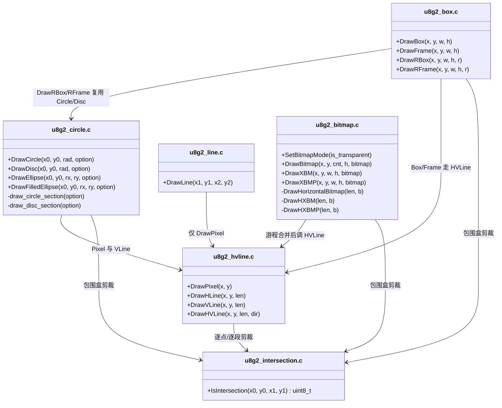
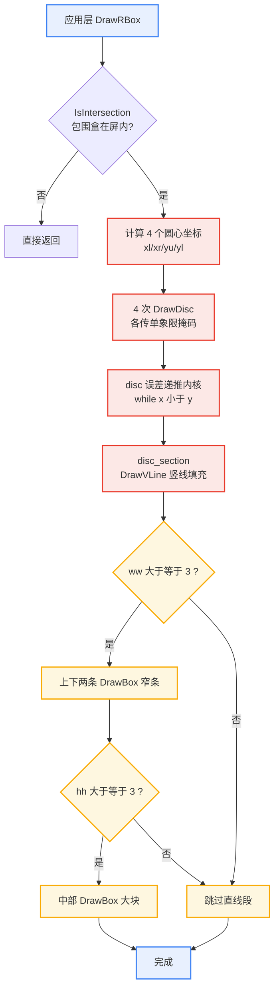
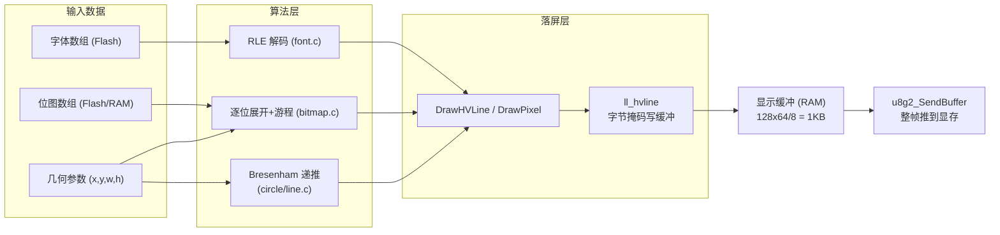

# u8g2 源码详解 11：图元绘制算法

> 涉及文件：
> - `csrc/u8g2_circle.c`（497 行，含中文导读）—— 圆/圆盘/椭圆
> - `csrc/u8g2_line.c`（111 行，含中文导读）—— 直线（注意：其上游版权头文件名误写为 u8g2_box.c）
> - `csrc/u8g2_bitmap.c`（292 行，含中文导读）—— 位图三格式
> - `csrc/u8g2_box.c`（233 行，含中文导读）—— 矩形四件套
> - 依赖：`csrc/u8g2_hvline.c`（DrawHVLine/DrawPixel 实现）、`csrc/u8g2_intersection.c`（剪裁窗口）、`csrc/u8g2_ll_hvline.c`（最终写缓冲）
>
> 姊妹篇：[10-字体引擎精读.md](10-字体引擎精读.md)
> KB 条目：clib_u8g2_circle / line / bitmap / box（Knowledge-Base/u8g2/ 目录）

---

## 1. 全景：图元函数族总表

四个文件合计 17 个公共入口，但底层只有 3 个"落屏原语"：

| 落屏原语 | 所在文件 | 说明 |
|---|---|---|
| `u8g2_DrawPixel(x,y)` | u8g2_hvline.c | 单点（经剪裁 + 旋转） |
| `u8g2_DrawHLine/VLine(x,y,len)` | u8g2_hvline.c | 水平/垂直线 |
| `u8g2_DrawHVLine(x,y,len,dir)` | u8g2_hvline.c | 0/90/180/270° 四方向线，最终都进 ll_hvline |

| 文件 | 公共入口 | 算法内核 | 画点方式 |
|---|---|---|---|
| u8g2_circle.c | DrawCircle / DrawDisc / DrawEllipse / DrawFilledEllipse | Bresenham 圆（误差递推）/ 中点椭圆（双区段） | Pixel（线框）/ VLine（实心） |
| u8g2_line.c | DrawLine | Bresenham 直线 | Pixel |
| u8g2_bitmap.c | DrawBitmap / DrawXBM / DrawXBMP（+H 单行版） | 逐位展开 + 同色游程合并 | HVLine |
| u8g2_box.c | DrawBox / DrawFrame / DrawRBox / DrawRFrame | 组合式（复用上面三个文件） | HVLine / Box / Circle / Disc |

所有入口的第一步几乎都是同一句剪裁（以 DrawCircle 为例，u8g2_circle.c:127~140）：

```c
void u8g2_DrawCircle(u8g2_t *u8g2, u8g2_uint_t x0, u8g2_uint_t y0, u8g2_uint_t rad, uint8_t option)
{
  /* check for bounding box */
#ifdef U8G2_WITH_INTERSECTION
  {
    if ( u8g2_IsIntersection(u8g2, x0-rad, y0-rad, x0+rad+1, y0+rad+1) == 0 ) 
      return;                                          /* u8g2_circle.c:132-133 */
  }
#endif /* U8G2_WITH_INTERSECTION */
  ...
```

包围盒整体与当前剪裁窗口不相交 → 一次判断直接返回，省掉整个算法循环。

---

## 2. 圆：Bresenham 误差递推（u8g2_circle.c:92~125）

```c
static void u8g2_draw_circle(u8g2_t *u8g2, u8g2_uint_t x0, u8g2_uint_t y0, u8g2_uint_t rad, uint8_t option)
{
    ...
    f = 1;              /* 误差项：起点 (0, rad) 处 f = 1 - rad */
    f -= rad;
    ddF_x = 1;          /* x 方向的二阶差分 */
    ddF_y = 0;
    ddF_y -= rad;
    ddF_y *= 2;
    x = 0;
    y = rad;

    u8g2_draw_circle_section(u8g2, x, y, x0, y0, option);   /* 先画 4 个轴端点 */
    
    while ( x < y )     /* 只算 1/8 圆弧，靠对称镜像 */
    {
      if (f >= 0)       /* 误差为正：圆弧内缩，y 向里收一步 */
      {
        y--;
        ddF_y += 2;
        f += ddF_y;
      }
      x++;
      ddF_x += 2;
      f += ddF_x;

      u8g2_draw_circle_section(u8g2, x, y, x0, y0, option);    
    }
}
```

要点拆解：

1. **决策变量 f = x²+y²-r² 的增量形式**。走一步 x：f += 2x+1（即 ddF_x 的累计）；
   走一步 y（内缩）：f += 1-2y。用 `ddF_x/ddF_y` 两个"二阶差分"避免了平方运算，
   每步只有加减。
2. **只算 1/8 弧**：`while (x < y)` 停在 45° 对称轴，8 个对称点由 section 函数展开。
3. **为什么用 `f >= 0` 而不是 f > 0**：中点算法取"中点在圆外/内"判断，边界归到
   内侧，保证 1/4 圆弧与镜像象限无缝衔接（否则对角处会缺像素）。

### 2.1 section 回调与四象限位掩码（u8g2_circle.c:61~90）

```c
static void u8g2_draw_circle_section(u8g2_t *u8g2, u8g2_uint_t x, u8g2_uint_t y, u8g2_uint_t x0, u8g2_uint_t y0, uint8_t option)
{
    /* upper right */
    if ( option & U8G2_DRAW_UPPER_RIGHT )
    {
      u8g2_DrawPixel(u8g2, x0 + x, y0 - y);
      u8g2_DrawPixel(u8g2, x0 + y, y0 - x);
    }
    ...
```

option 是 4 位掩码（u8g2.h:1895~1899）：`UPPER_RIGHT=0x01, UPPER_LEFT=0x02,
LOWER_LEFT=0x04, LOWER_RIGHT=0x08, ALL=0x0F`。每个象限画 2 个点（(x,y) 与
交换后的 (y,x)），所以一次 section 最多落 8 个像素。**DrawRBox/DrawRFrame 画
圆角就是给这里传单象限掩码**——四分之一圆弧免费复用。

象限与点坐标对照（右上象限为例）：

| 掩码位 | 落点 1 | 落点 2 |
|---|---|---|
| U8G2_DRAW_UPPER_RIGHT | (x0+x, y0-y) | (x0+y, y0-x) |
| U8G2_DRAW_UPPER_LEFT | (x0-x, y0-y) | (x0-y, y0-x) |
| U8G2_DRAW_LOWER_RIGHT | (x0+x, y0+y) | (x0+y, y0+x) |
| U8G2_DRAW_LOWER_LEFT | (x0-x, y0+y) | (x0-y, y0+x) |

### 2.2 圆盘（Disc）：同样的内核，换 VLine 填充

`u8g2_draw_disc`(:178) 与 draw_circle **逐行相同的递推内核**（对比 :100~124 与
:186~211 完全一致），差别只在 section：把每对对称点画成两条竖直线
`u8g2_DrawVLine(x0+x, y0-y, y+1)`——从 (x0+x, y0-y) 向下画 y+1 个像素到中线。
即**扫描线填充复用了圆弧扫描**，一个循环同时填左右两半，无逐点判内切。

### 2.3 椭圆：双区段中点算法（u8g2_circle.c:262~349）

椭圆曲率在长短轴处差异大，单一误差项会失真，所以 `u8g2_draw_ellipse` 分两个
阶段（Foley《Computer Graphics》p.90 的经典算法，源码注释 :230-233 亦有标注）：

| 阶段 | 起点 | 停止条件 | 主导误差 |
|---|---|---|---|
| 区段 1（|斜率|<1，沿 y 走） | (rx, 0) | `stopx >= stopy` | ychg（rx²） |
| 区段 2（|斜率|>1，沿 x 走） | (0, ry) | `stopx <= stopy` | xchg（ry²） |

变量 `rxrx2 = 2rx²`、`ryry2 = 2ry²`、`xchg/ychg` 是两个方向的决策增量，
`err` 累积误差。整数乘法只出现在初始化（rx*rx*2 等 4 次），循环体内纯加减。
`u8g2_draw_filled_ellipse`(:395) 同内核，section 改画 VLine。

---

## 3. 直线：整数 Bresenham（u8g2_line.c:58~110）

```c
void u8g2_DrawLine(u8g2_t *u8g2, u8g2_uint_t x1, u8g2_uint_t y1, u8g2_uint_t x2, u8g2_uint_t y2)
{
  ...
  uint8_t swapxy = 0;
  
  /* no intersection check at the moment, should be added... */   /* :68 */

  if ( x1 > x2 ) dx = x1-x2; else dx = x2-x1;      /* :70 绝对值 */
  if ( y1 > y2 ) dy = y1-y2; else dy = y2-y1;

  if ( dy > dx )                                    /* :73 斜率>1：交换 xy 轴 */
  {
    swapxy = 1;
    tmp = dx; dx =dy; dy = tmp;
    tmp = x1; x1 =y1; y1 = tmp;
    tmp = x2; x2 =y2; y2 = tmp;
  }
  if ( x1 > x2 )                                    /* :80 保证从左往右 */
  {
    tmp = x1; x1 =x2; x2 = tmp;
    tmp = y1; y1 =y2; y2 = tmp;
  }
  err = dx >> 1;                                    /* :85 误差初值 dx/2 */
  if ( y2 > y1 ) ystep = 1; else ystep = -1;
  y = y1;

#ifndef  U8G2_16BIT
  if ( x2 == 255 )                                  /* :90 终点回绕防御 */
    x2--;
#else
  if ( x2 == 0xffff )
    x2--;
#endif

  for( x = x1; x <= x2; x++ )                       /* :97 主循环 */
  {
    if ( swapxy == 0 ) 
      u8g2_DrawPixel(u8g2, x, y); 
    else 
      u8g2_DrawPixel(u8g2, y, x); 
    err -= (u8g2_uint_t)dy;
    if ( err < 0 ) 
    {
      y += (u8g2_uint_t)ystep;
      err += (u8g2_uint_t)dx;
    }
  }
}
```

四个细节：

1. **swapxy**：Bresenham 主循环沿"主轴"步进，斜率>1 时把 y 当主轴（交换 x/y），
   画点时再换回来——一个标志位替代两套循环。
2. **err = dx/2 起步**：等价于"以线段中点做决策"，保证上下半平面的像素分布对称，
   线不会整体偏移半像素。
3. **x2 == 255/0xffff 先减一**：u8g2_uint_t 无符号，`x <= x2` 在 x2=MAX 时
   x++ 回绕成 0 变死循环。这是嵌入式无符号计数的经典防御，值得记笔记。
4. **没有窗口剪裁**（:68 原注释自述），越界靠 DrawPixel 内部逐点兜底；
   水平/垂直线应走 DrawHLine/DrawVLine 快速路径，不要用 DrawLine 画框。

---

## 4. 位图：三种格式与游程合并（u8g2_bitmap.c）

### 4.1 格式对照表

| 入口 | 行内位序 | 每行字节数 | 数据位置 | 单行底层 |
|---|---|---|---|---|
| DrawBitmap(:103) | MSB-first（mask 从 0x80） | 参数 cnt 直接给 | RAM | DrawHorizontalBitmap(:67) |
| DrawXBM(:184) | LSB-first（mask 从 0x01） | (w+7)/8（自动算） | RAM | DrawHXBM(:124) |
| DrawXBMP(:272) | LSB-first | (w+7)/8 | **AVR PROGMEM**（u8x8_pgm_read 读） | DrawHXBMP(:209) |

XBM 是 X11 传统格式（LSB-first），u8glib 老 Bitmap 是 MSB-first——两套并存
是为兼容两个生态；XBMP 与 XBM 唯一差别是读数据的函数。
位图与字体的 RLE 无关，它是**未压缩的行位图**。

### 4.2 关键优化：同色游程合并（DrawHXBM :153~177）

```c
#else
    u8g2_uint_t run_length = 0;
    // Determine the run length of consecutive bits with the same color
    while (len > 0 && (current_bit == 0 ? (((*b) & mask) == 0) : (((*b) & mask) != 0 )  ))
    {
        run_length++;
        x++;
        mask <<= 1;
        if (mask == 0)
        {
            mask = 1;
            b++;
        }
        len--;
    }
    if (current_bit)
    {
        u8g2->draw_color = color;
        u8g2_DrawHVLine(u8g2, x - run_length, y, run_length, 0);   /* :171 */
    }
    else if (u8g2->bitmap_transparency == 0)
    {
        u8g2->draw_color = ncolor;
        u8g2_DrawHVLine(u8g2, x - run_length, y, run_length, 0);
    }
#endif
```

旧实现（`#ifdef OLD` 分支保留在 :138~152）每 bit 一次 `DrawHVLine(...,1,0)`；
新实现先数出"连续同色位"的长度 run_length，再一次性画
`DrawHVLine(x - run_length, y, run_length, 0)`。注意 `x` 在数游程时已经前移，
所以画的时候要**回退 run_length**——这是阅读这段代码最容易迷糊的一步。
对大面积同色位图（图标、logo），调用次数差一个数量级。

透明模式语义：`u8g2_SetBitmapMode(1)` 时 0 位跳过（保背景），
0 时用 ncolor（前景色取反）补底——与字体透明模式同一套思想。

---

## 5. 矩形四件套：组合复用（u8g2_box.c）

### 5.1 DrawBox / DrawFrame（:65~106）

```c
void u8g2_DrawBox(u8g2_t *u8g2, u8g2_uint_t x, u8g2_uint_t y, u8g2_uint_t w, u8g2_uint_t h)
{
#ifdef U8G2_WITH_INTERSECTION
  if ( u8g2_IsIntersection(u8g2, x, y, x+w, y+h) == 0 ) 
    return;
#endif /* U8G2_WITH_INTERSECTION */
  while( h != 0 )
  { 
    u8g2_DrawHVLine(u8g2, x, y, w, 0);      /* :73 整行填充，库中最快大面积路径 */
    y++;    
    h--;
  }
}
```

DrawFrame（:84~106）用 4 条线拼边框，并做两级防御：`h>=2` 才画左右竖边
（h=1 时只有上边线），内部 `h>0` 才画竖边——避免角点重复画与负长度。

### 5.2 DrawRBox / DrawRFrame：圆角 = 四象限圆弧 + 补心

DrawRBox(:111~167) 的组装：

1. 算 4 个圆心：`(x+r, y+r)`、`(x+w-r-1, y+r)`、`(x+r, y+h-r-1)`、`(x+w-r-1, y+h-r-1)`；
2. 各画 1/4 `u8g2_DrawDisc`（传单象限掩码，circle.c 免费复用）；
3. 顶部/底部各一条 `DrawBox(xl, y, ww, r+1)` 窄条 + 中部 `DrawBox(x, yu, w, hh)` 大块。

DrawRFrame(:170~232) 同理，Disc 换 Circle、Box 换 HLine/VLine。
注意 `-1` 的出现：右/下圆心都要减 1，因为矩形右边线的像素在 x+w-1（半开区间
[x, x+w)），两边圆弧若都取 x+w-r 会在角落重叠或错位 1 像素。

**陷阱**：`r` 过大（2r > w 或 h）时 `ww/hh` 计算为负，直线段被 `if (ww >= 3)`
跳过，但四段圆弧会交叠出畸形图形——调用者必须保证 `r <= min(w,h)/2`。

---

## 6. 图元函数族（classDiagram）



---

## 7. 执行流与数据流

### 7.1 一次 DrawRBox 的执行流（flowchart TD）



### 7.2 图元数据流（flowchart LR）



---

## 8. 陷阱与实测建议

| # | 陷阱 | 说明 | 建议 |
|---|---|---|---|
| 1 | DrawLine 到屏幕右边界死机 | x2=255/0xffff 已有防御，但自算参数越界仍会触发逐点兜底慢路径 | 大量直线场景先自做包围盒判断 |
| 2 | DrawLine 画框慢 | 每像素一次 DrawPixel 全流程 | 框用 DrawFrame，横竖线用 HLine/VLine |
| 3 | 圆角矩形 r 太大出怪图 | 2r 超边长时圆弧交叠（box.c 无守卫） | 调用方保证 r 小于等于 min(w,h)/2 |
| 4 | XBM 显示镜像/乱码 | 把 XBM 数据喂给 DrawBitmap（位序相反） | XBM 数据必须配 DrawXBM；MSB 数据配 DrawBitmap |
| 5 | PROGMEM 位图在非 AVR 上正常、AVR 上乱码 | DrawXBM 直接解引用，AVR 需 pgm 读 | AVR 用 DrawXBMP |
| 6 | 透明位图边缘有"反色噪点" | bitmap_transparency=0 时 0 位画反色 | 只想叠加前景就 SetBitmapMode(1) |
| 7 | DrawDisc 半径大时闪烁/慢 | 每 1/8 弧两条 VLine，大半径 VLine 数量多 | 静态圆盘预生成 XBM 数组存 Flash |

**读码路径**：`u8g2_DrawBox`(box.c:65)（最简单，先建立"图元=hvline 组合"的直觉）
→ `u8g2_DrawLine`(line.c:58)（Bresenham 最小实现）→ `u8g2_draw_circle`(circle.c:92)
（误差项+对称展开）→ `u8g2_DrawRBox`(box.c:111)（组合复用的范例）→
`u8g2_DrawHXBM`(bitmap.c:124)（游程合并优化），最后扫一眼
`u8g2_IsIntersection`（intersection.c）理解所有入口第一行剪裁的来龙去脉。
